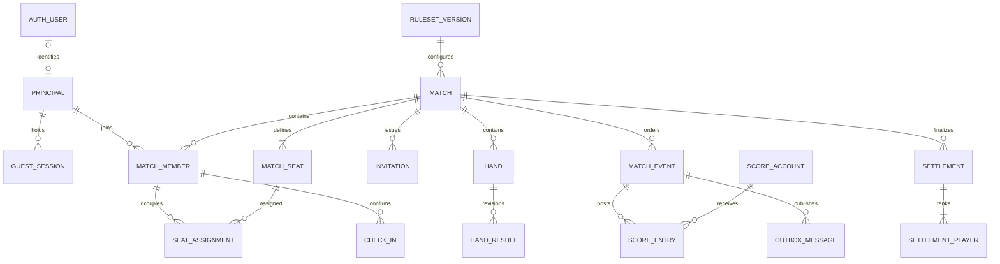

# PostgreSQL 数据库设计

版本：1.0　日期：2026-10-19

本设计对应已经确认的产品：三端、账户安全、全员共同录入、实时同步、开局二维码签到。以下已细化到表、关键字段、关系、约束、索引和事务流程；属于开发设计稿，尚未生成正式 ORM migration 或在数据库执行。

## 1. 设计原则

推荐 PostgreSQL。身份、座位、签到、局结果和账本使用关系表；JSONB 只承载规则快照、不同事件的输入参数及可重建状态快照。实时通信使用 WebSocket，持久化与并发正确性由数据库事务保障。

分数事实来自点数流水；玩家当前分数是可重算的投影。每个成员都能提交事件，但不得直接修改总分字段。账户封禁、成员移除、修订与注销也需要与业务权限和审计联动。

通用约定：业务主键 `uuid`；服务端时间 `timestamptz`，存储和计算使用 UTC；点数 `integer`；事件序号与版本 `bigint`；竞技分最小单位用整数十分之一分；状态使用带 `CHECK` 的文本或集中定义的枚举。客户端时间仅作辅助信息，不决定事件顺序和签到有效期。

## 2. 核心关系



图中的 `AUTH_USER` 由认证组件管理；`PRINCIPAL` 是业务操作者，可对应正式账户或受限访客。房主是成员的一种管理权限，不是唯一允许记分的人。

计划书中的 `PlayerProfile` 是产品概念，落库由 `principals`、偏好与统计投影共同表达，不再另建一套独立身份。`PresenceSession` 对应邀请与签到记录；`LedgerEntry` 对应本设计的 `score_entries`。

## 3. 身份与账户

### 3.1 认证组件管理的表

采用 Better Auth 时，由锁定版本及启用插件生成账户、会话、凭证、验证令牌和 TOTP 表。实际表名、列名以生成 migration 为准，不能手写一个不兼容的 `users/password` 表后又接入组件。业务表只通过认证用户 ID 建立映射，不重复保存密码或 MFA 密钥。[认证组件说明](https://better-auth.com/docs/introduction)、[会话说明](https://better-auth.com/docs/concepts/session-management)。

认证数据的读权限只给认证服务。会话撤销是修改权威会话记录，而不只是删除前端 Cookie；管理员角色不接受客户端提供的字段。系统管理员角色与牌局房主角色分开存储。

### 3.2 业务身份表

| 表 | 关键字段 | 约束与用途 |
|---|---|---|
| `principals` | `id uuid PK`、`kind`、`auth_user_id text NULL`、`display_name`、`status`、`created_at` | `kind=user/guest/erased`；非空 `auth_user_id` 唯一且关联认证用户；正式用户要求存在对应认证身份 |
| `guest_sessions` | `id`、`principal_id FK`、`match_id FK`、`token_verifier`、`expires_at`、`revoked_at` | 限本桌使用；随机凭证保存不可逆校验值；同一访客可续期，不以昵称认证 |
| `principal_links` | `source_principal_id PK/FK`、`target_principal_id FK`、`linked_at`、`approved_by` | 访客战绩迁移时记录身份关联；禁止自关联、环及多级未归一化映射 |
| `user_preferences` | `principal_id PK/FK`、`locale`、`theme`、`sound_enabled`、`reduced_motion` | 不保存认证凭证；未来视觉设置独立升级 |
| `system_roles` | `principal_id FK`、`role`、`granted_by`、`granted_at` | `(principal_id, role)` 唯一；授予管理员需单独审计 |

访客迁移到已有账户时，按第 8 节的统一顺序锁定涉及身份和牌局，检查双方是否已占同一桌的不同座位；存在冲突不能直接合并。迁移成员与战绩归属后保存身份链接，历史事件作者保持原始 ID，并通过受控关联解析。注销时清除这些关联，避免匿名身份继续指向被删账户。

`auth_user_id` 的类型在接入认证组件时对齐；若组件允许配置 schema，认证表放 `auth`，业务表放 `app`。不要通过级联删除认证用户把其他人的共享牌局一起删掉。

## 4. 牌局、成员和规则

| 表 | 关键字段 | 核心约束 |
|---|---|---|
| `ruleset_versions` | `id`、`template_key`、`version int`、`player_count smallint`、`config jsonb`、`config_hash`、`engine_version`、`published_at` | `(template_key, version)` 唯一；人数只允许 3 或 4；发布后不可修改 |
| `matches` | `id`、`owner_principal_id FK`、`ruleset_version_id FK`、`rules_snapshot jsonb`、`rules_hash`、`state`、`version bigint`、`current_hand_id NULL`、`started_at`、`ended_at` | 版本非负；开局后规则快照不可变；状态转换经业务服务 |
| `match_members` | `id`、`match_id FK`、`principal_id FK`、`role`、`status`、`joined_at`、`removed_at` | `(match_id, principal_id)` 唯一；`role=participant/spectator`；房主权限由 matches 指向 |
| `match_seats` | `match_id FK`、`seat_no smallint`、`initial_wind` | `(match_id, seat_no)` 主键；座位范围由人数校验；初始风位唯一 |
| `seat_assignments` | `id`、`match_id`、`seat_no`、`member_id`、`start_hand_no int`、`end_hand_no int NULL`、`confirmed_by` | 同座位占用区间不重叠；同一成员不能同时占两座；同桌复合外键 |
| `match_devices` | `id`、`match_id`、`member_id`、`device_label`、`last_seen_at`、`last_acked_seq` | 一个成员允许手机与网页同时打开；在线状态不等于到场状态 |

每个表的 UUID 外键还要验证属于同一牌局。例如 `seat_assignments(match_id, member_id)` 指向 `match_members(match_id, id)`，而不是只验证 `member_id` 存在。相应被引用表建立 `UNIQUE(match_id, id)`，避免把另一桌成员误接到当前座位。

首发可使用 `btree_gist` 与排斥约束阻止座位时间区间交叠；如不启用扩展，所有入座／换人操作必须持有同一个牌局行锁并进行区间冲突检查。区间采用 `[start_hand_no, end_hand_no)`，空结束值表示仍在座；换人仅在局与局之间生效，过去的局仍关联旧分配记录。

建议索引：`match_members(principal_id, status, match_id)`；`matches(owner_principal_id, started_at DESC)`；`matches(state, updated_at)`；`seat_assignments(match_id, start_hand_no)`。`updated_at` 为 matches 的通用更新时间字段。

## 5. 二维码与到场确认

| 表 | 关键字段 | 约束与行为 |
|---|---|---|
| `match_invitations` | `id`、`match_id FK`、`token_hash`、`scope`、`generation int`、`expires_at`、`revoked_at`、`created_by` | `token_hash` 唯一；`scope=join/watch` 明确区分；二维码可多人申请，不在首人扫码后整体消费 |
| `join_requests` | `id`、`match_id`、`invitation_id`、`principal_id`、`requested_seat_no`、`status`、`approved_by`、`created_at` | 同一身份同一邀请的重复申请幂等；批准前无参赛写权限 |
| `check_ins` | `id`、`match_id`、`member_id`、`seat_assignment_id`、`rules_hash`、`method`、`confirmed_at`、`host_confirmed_at`、`host_confirmed_by` | 同一有效座位分配只保留一份当前签到；`method=qr/manual_code`；不存 GPS 或蓝牙地址 |

签到确认必须绑定规则摘要。开局前换规则时使原确认失效并重新确认，防止玩家同意的是旧规则。二维码过期不撤销已经成功完成的入桌；开局后撤销所有 `join` 邀请，已有成员会话继续有效。

开始牌局是一个事务：锁 matches 行 → 检查状态与当前规则版本 → 检查 3／4 个不重复有效座位 → 检查每个成员已确认及房主已核对 → 写开局事件 → 建立第一局 → 更新状态和版本 → 生成推送记录。房主也需要完成自己的参赛签到。

`expires_at` 由服务端时间判断；不使用 `WHERE expires_at > now()` 之类会随时间变化的条件来表达“当前有效”的唯一索引。有效期检查是每次操作的事务条件。

## 6. 每一局与事件账本

### 6.1 局与结果

| 表 | 关键字段 | 约束 |
|---|---|---|
| `hands` | `id`、`match_id FK`、`hand_no int`、`round_wind`、`round_number`、`dealer_seat_no`、`honba`、`riichi_pool_before`、`state`、`opened_at` | `(match_id, hand_no)` 唯一；`hand_no` 每次重打也递增，东一局 0 本场不能充当唯一 ID |
| `hand_results` | `id`、`match_id`、`hand_id`、`revision int`、`kind`、`input jsonb`、`calculation jsonb`、`engine_version`、`created_by`、`superseded_at NULL` | `(hand_id, revision)` 唯一；每局最多一个未被替代的有效结果 |
| `result_winners` | `result_id`、`seat_no`、`han`、`fu`、`yakuman_count`、`deal_in_seat_no NULL`、`pao_seat_no NULL` | `(result_id, seat_no)` 唯一；双响在同一个 result 下有两行；角色合法性在规则引擎校验 |
| `riichi_declarations` | `id`、`match_id`、`hand_id`、`seat_no`、`event_id`、`cancelled_by_event_id NULL` | 每局每座最多一份当前有效立直；撤销留记录，不能重复扣棒 |

JSONB 中记录各役、符明细、计算输入和说明；支付流水仍规范化保存。`result_winners` 字段表示人工输入或引擎结果的不同来源时，另存 `input_mode=han_fu/hand/manual_adjustment`，不能将人工确认伪装为自动验牌。

### 6.2 事件与点数流水

| 表 | 关键字段 | 约束 |
|---|---|---|
| `match_events` | `id uuid`、`match_id`、`seq bigint`、`hand_id NULL`、`actor_principal_id`、`client_event_id uuid`、`request_hash`、`type`、`payload jsonb`、`created_at` | `(match_id, seq)` 唯一；`(match_id, actor_principal_id, client_event_id)` 唯一 |
| `score_accounts` | `id`、`match_id`、`kind`、`seat_no NULL`、`opening_balance int` | 座位账户每座唯一；供托账户每桌唯一；必要时增加处罚池；初始点数明确 |
| `score_entries` | `id`、`match_id`、`event_id`、`account_id`、`amount int`、`reason` | 一条转移对应若干正负流水；同事件所有账户净变动为 0 |
| `match_snapshots` | `match_id`、`seq`、`state jsonb`、`engine_version`、`state_hash` | `(match_id, seq)` 主键；可丢弃重建；不作为客户端改分入口 |
| `outbox_messages` | `id`、`event_id`、`topic`、`payload jsonb`、`attempts`、`next_attempt_at`、`published_at NULL` | `(event_id, topic)` 唯一；与业务事务一起提交；允许重复投递 |
| `sync_cursors` | `member_id`、`device_id`、`match_id`、`last_acked_seq`、`updated_at` | 同成员设备牌局唯一；只用于补拉，不授予权限 |

重要区别：同一事件重试由幂等约束解决；两个人用不同事件 ID 报同一局，由有效结果唯一约束和版本检查解决。只做其中一个是不够的。

统一约定 `matches.version` 等于最新已提交 `match_events.seq`。入座、移除成员、确认规则等影响共享状态的操作也追加事件并推进版本；仅心跳和设备游标更新不推进。纯管理事件没有点数流水，不能为凑齐结构生成虚假支付。

### 6.3 账本示例

四麻初始每座 `opening_balance=25,000`，供托账户初始为 0。A 立直：

| 事件 | 账户 | amount |
|---|---|---:|
| A 宣告立直 | A 座位账户 | −1,000 |
| A 宣告立直 | 供托账户 | +1,000 |

之后 B 从 C 荣和 3,900 点并取得这一根供托：

| 事件 | 账户 | amount |
|---|---|---:|
| 本局结算 | C 座位账户 | −3,900 |
| 本局结算 | B 座位账户 | +4,900 |
| 本局结算 | 供托账户 | −1,000 |

每个事件的净变动都为 0；供托未重复从放铳者扣除。当前余额为 `opening_balance + SUM(amount)`。记录人是谁不影响获胜座位或付款座位。

事件总额的跨行求和不能用普通单行 CHECK 正确表达；建议用提交时执行的延迟约束触发器，同时由服务层和回归测试验证。立直供托不得为负；玩家持点可因飞人而变为负数。限定应用账号只能调用受控写入路径，禁止任意删改历史流水。[PostgreSQL 约束说明](https://www.postgresql.org/docs/current/ddl-constraints.html)。

## 7. 数据库防重复约束示例

以下 SQL 只是设计中的索引片段，依赖前述表与外键已经创建，不能作为完整 migration 单独执行。

```sql
CREATE UNIQUE INDEX uq_active_hand_result
    ON hand_results (hand_id)
    WHERE superseded_at IS NULL;

CREATE UNIQUE INDEX uq_active_riichi
    ON riichi_declarations (hand_id, seat_no)
    WHERE cancelled_by_event_id IS NULL;

CREATE UNIQUE INDEX uq_match_event_sequence
    ON match_events (match_id, seq);

CREATE UNIQUE INDEX uq_match_event_retry
    ON match_events (match_id, actor_principal_id, client_event_id);

CREATE INDEX ix_outbox_pending
    ON outbox_messages (next_attempt_at, id)
    WHERE published_at IS NULL;

CREATE INDEX ix_score_entries_by_account
    ON score_entries (account_id, event_id);
```

局结果被修订时，在同一事务内先标记旧结果被替代，再插入新修订结果；其他连接只能在提交后看到完整变更。普通写入账号不得用更新 `superseded_at` 绕过修订流程。部分唯一索引表达“最多一个有效结果”，而不是阻止保存历史修订。[PostgreSQL 部分索引](https://www.postgresql.org/docs/current/indexes-partial.html)。

## 8. 多人同时录入的事务

首发按牌局串行处理短事务，同一桌每次写只锁这一桌，不锁全站。采用默认隔离级别配合显式行锁、版本条件和唯一约束。授权移除、开局、换座、结算和修订都遵循一致锁顺序，避免权限检查与写入竞态。[PostgreSQL 行锁](https://www.postgresql.org/docs/current/explicit-locking.html)。

```text
验证在线身份／会话
BEGIN
  1. 按稳定 ID 顺序锁涉及的身份及会话记录，复核有效性
  2. SELECT matches ... FOR UPDATE，取得当前牌局状态与 version
  3. 在牌局锁保护下复核当前成员、座位与写入权限
  4. 查找该 actor + clientEventId
       已存在且请求哈希相同 → 返回已保存结果
       已存在但内容不同 → 拒绝复用 ID
  5. 检查 handId、expectedVersion、牌局状态
       版本过旧或局已结算 → 返回冲突及最新版本，保留客户端草稿
  6. 用固定 rulesSnapshot + engineVersion 重算输入
  7. 写 MatchEvent(seq = version + 1)
  8. 写 HandResult、所有胜者、ScoreEntries、必要的下一局
  9. 更新当前状态投影和 matches.version
 10. 写 OutboxMessage
COMMIT
返回服务器接受结果；独立推送任务发布事件
```

会话撤销、封禁与业务写入要定义原子先后关系：授权时对相关身份和会话记录使用共享行锁，撤销／封禁时取得与其冲突的写锁；撤销提交之后开始授权检查的请求必须失败。统一锁顺序为身份 → 会话 → 牌局，同类多行按稳定 ID 排序；所有移除、迁移和注销路径必须遵守。认证组件的撤销路径需要验证能遵守该协议，不能仅凭前端清除 Cookie 或短时缓存声称即时撤销。

事务内不发邮件、不等 WebSocket、不等待人工确认。推送采用至少一次投递；消费端按事件 ID 去重，按 seq 检测缺口并补拉。请求重试返回保存结果前仍须通过当前访问权限，防止被踢成员借重试读取私密数据。

`request_hash` 由服务端对规范化业务请求生成，至少覆盖牌局、局 ID、操作类型及结果输入；不能把它当作用户签名或身份凭证。离线队列恢复时，同一已接受事件可查询原结果；冲突编辑产生新请求 ID 并保留原草稿关系。

## 9. 修订、结算与统计

| 表 | 关键字段 | 行为 |
|---|---|---|
| `revision_requests` | `id`、`match_id`、`target_event_id`、`base_version`、`proposed_input jsonb`、`reason`、`requested_by`、`reviewed_by`、`status` | 纠错提议单独保存；复核后产生新事件 |
| `disputes` | `id`、`match_id`、`hand_id NULL`、`created_by`、`reason`、`status`、`resolved_by` | 争议不是删除记录；保留处理过程 |
| `settlements` | `id`、`match_id`、`revision`、`source_seq`、`created_at`、`superseded_at` | 每桌最多一份有效终局结算；绑定输入事件版本 |
| `settlement_players` | `settlement_id`、`seat_no`、`principal_id`、`final_points`、`rank`、`uma_tenths`、`oka_tenths`、`total_tenths` | 每次结算每座唯一；整数十分之一竞技分 |
| `settlement_confirmations` | `settlement_id`、`member_id`、`status`、`confirmed_at` | 区分已结算、部分核对、全员核对；修订后旧确认不自动继承 |
| `settlement_participations` | `settlement_id`、`seat_assignment_id`、`principal_id`、`hands_played`、`full_match` | 每次结算每份座位分配唯一；保留中途换人的参与归属 |
| `player_stats` | `principal_id`、`ruleset_version_id`、`rules_hash`、`period_key`、`match_count`、`rank_counts`、`score_tenths`、`source_version` | 按身份、实际规则摘要与周期分组；可重建投影，不与账本形成双重事实来源 |

最近一次无依赖事件可追加冲销。修改较早和牌结果可能改变本场、庄家和后续所有局次，不能只改某条分数差；应重放受影响后缀，展示变化并确认。新旧结果、冲销及重算流水在一个修订批次中关联，旧数据保留审计痕迹；最终快照和统计切换到新有效版本。

MVP 建议将历史中段修订做成有复核的流程，并在修订过程中暂停该牌局写入，完成后广播新版本。已结算牌局修订需重算终局和对应统计，不靠在总分后面补一个看不懂的数。

和牌率可按某玩家已参与的有效局数作分母；放铳率同样按局计，一个人在双响中放铳只算该局一次。三麻、四麻及不同规则版本分开统计。没有完整副露数据时不展示副露率。

发生中途换人时，终局分数与名次属于座位，`settlement_players.principal_id` 只表示结束时的占座者；个人逐局指标依据各局的座位分配计算。建议首发将换人对局标记为非完整参赛，不计入个人整场顺位／竞技分榜，避免把两个人的表现全部算给最后一人；该统计口径需在产品中明确展示。

## 10. 隐私、权限与运维数据

| 表 | 关键字段 | 要求 |
|---|---|---|
| `audit_logs` | 操作者、动作、资源、请求 ID、时间、变更版本、脱敏元数据 | 应用账号仅追加；限制查询；敏感凭证不进入日志 |
| `export_jobs` | 申请人、范围、状态、文件引用、过期时间 | 下载时再次校验身份／权限；文件与链接到期清理 |
| `deletion_jobs` | 目标身份、申请时间、执行步骤、状态、完成时间 | 重试幂等；包含认证、身份关联、缓存、导出文件、日志策略与备份恢复清理 |
| `security_events` | 事件类型、主体、粗粒度来源、时间、风险等级 | 限期保留与访问；不向同桌暴露 IP 或登录详情 |

数据库角色分为迁移账号、运行账号、只读运维账号和备份账号。运行账号无 DDL 权限，不共用超级用户；对审计和账本限制 UPDATE／DELETE。行级安全可作为后续纵深保护，但不能替代服务端成员校验，也不能在连接池里使用会泄漏到下一请求的会话级用户变量。

对账户删除使用明确流程，FK 默认采用 RESTRICT 或合适的 SET NULL；不能从 auth user 一路 CASCADE 删除完整共享比赛。清除身份关联与可识别内容后是否保留匿名局结果，按产品隐私政策及适用要求执行。

建议索引另包括 `match_events(match_id, seq)`、`hands(match_id, hand_no)`、`audit_logs(created_at)`、`security_events(principal_id, created_at DESC)`、`settlement_players(principal_id, settlement_id)`。认证令牌、邀请码和待处理队列按实际查询建立索引；不默认给所有 JSONB 建 GIN。

## 11. 数据库专项验收

- 4 个并发事务提交同一局，最终只有 1 个有效结果，账本总额守恒。
- 幂等请求发生在连接断开、提交成功但响应丢失之后，仍能返回原结果。
- 立直、双响、供托、本场、三麻与终局结算的流水能逐条重建余额。
- 用另一桌的 memberId、seatId、handId 或 accountId 写入时，复合外键或服务事务拒绝。
- 两个人认领同一座位、二维码换代期间提交、开局瞬间有人退出均保持一致。
- 推送进程在业务提交后崩溃，重启可从 outbox 补发，客户端不会重复应用。
- 修订历史后，当前状态、终局和统计一致，旧确认不会错误继承。
- 访客迁移与账号注销不串接其他账户，不破坏其余玩家的共同记录。
- 数据库备份恢复到空实例后，能重放事件、恢复队列并重新执行删除清单。

下一步实现产物应是认证组件生成的 schema、业务 migration、种子规则和上述并发／恢复测试。本次仅完成设计文档与约束示例，未声称这些验证已经通过。
