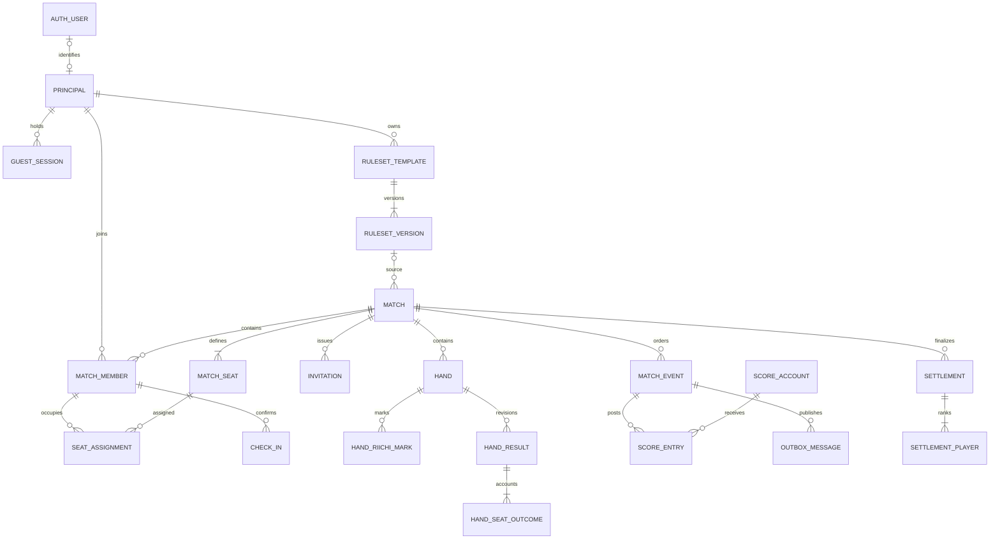

# PostgreSQL 数据库设计

版本：1.3　日期：2026-10-19

本设计对应已经确认的产品：三端、账户安全、全员共同录入、实时同步、开局二维码签到。以下已细化到表、关键字段、关系、约束、索引和事务流程；属于开发设计稿，尚未生成正式 ORM migration 或在数据库执行。

## 1. 设计原则

推荐 PostgreSQL。身份、座位、签到、局结果和账本使用关系表；JSONB 只承载规则快照、不同事件的输入参数及可重建状态快照。实时通信使用 WebSocket，持久化与并发正确性由数据库事务保障。

分数事实来自点数流水；玩家当前分数是可重算的投影。局中立直只是带版本的共享标记，成立的立直扣棒与本局结果在同一结算事件入账。每个成员都能提交标记与结算，但不得直接修改总分字段。账户封禁、成员移除、修订与注销也需要与业务权限和审计联动。

通用约定：业务主键 `uuid`；服务端时间 `timestamptz`，存储和计算使用 UTC；点数 `integer`；事件序号与版本 `bigint`；竞技分最小单位用整数十分之一分；状态使用带 `CHECK` 的文本或集中定义的枚举。客户端时间仅作辅助信息，不决定事件顺序和签到有效期。

## 2. 核心关系



图中的 `AUTH_USER` 由认证组件管理；`PRINCIPAL` 是业务操作者，可对应正式账户或受限访客。房主是成员的一种管理权限，不是唯一允许记分的人。

计划书中的 `PlayerProfile` 是产品概念，落库由 `principals`、偏好与统计投影共同表达，不再另建一套独立身份。`PresenceSession` 对应邀请与签到记录；`LedgerEntry` 对应本设计的 `score_entries`。

## 3. 身份与账户

### 3.1 认证组件管理的表

采用 Better Auth 时，由锁定版本及启用插件生成账户、会话、凭证、验证令牌和 TOTP 表。实际表名、列名以生成 migration 为准，不能手写一个不兼容的 `users/password` 表后又接入组件。业务表只通过认证用户 ID 建立映射，不重复保存密码或 MFA 密钥。[认证组件说明](https://better-auth.com/docs/introduction)、[会话说明](https://better-auth.com/docs/concepts/session-management)。

认证数据由 Better Auth 管理；业务服务调用其会话校验接口，不跨 schema 直接锁或改 `auth.session`。首发选择数据库会话并关闭 Cookie／二级会话缓存，确保撤销后新的请求读到权威状态；已有请求可能完成，不能声称撤销与业务事务全局原子。管理员角色不接受客户端提供的字段；首发仅有受限运维命令，完整后台与管理员 MFA 作为同一后续交付。系统管理员与牌局房主分开。

### 3.2 业务身份表

| 表 | 关键字段 | 约束与用途 |
|---|---|---|
| `principals` | `id uuid PK`、`kind`、`auth_user_id text NULL`、`display_name`、`status`、`created_at` | `kind=user/guest/erased`；非空 `auth_user_id` 唯一；正式用户的对应认证身份由服务确认，注销时匿名化 |
| `guest_sessions` | `id`、`principal_id FK`、`match_id FK`、`token_verifier`、`expires_at`、`revoked_at` | 限本桌使用；随机凭证保存不可逆校验值；同一访客可续期，不以昵称认证 |
| `principal_links` | `source_principal_id PK/FK`、`target_principal_id FK`、`linked_at`、`approved_by` | 访客升级时保留历史作者 ID，仅将统计归属解析到正式账户；禁止自关联、环及多级映射 |
| `member_access_grants` | `member_id FK`、`principal_id FK`、`granted_at`、`revoked_at` | 升级账户取得原访客成员的访问权；同一有效授权唯一，旧访客会话撤销 |
| `guest_recovery` | `id`、`guest_session_id FK`、`seat_assignment_id FK`、`secret_hash`、`expires_at`、`used_at` | 丢失设备后的单次恢复凭证，仅在房主／共同主持现场核对后消费；限流、审计 |
| `user_preferences` | `principal_id PK/FK`、`locale`、`theme`、`sound_enabled`、`reduced_motion` | 不保存认证凭证；未来视觉设置独立升级 |
| `user_default_rulesets`（P1） | `principal_id FK`、`player_count smallint`、`ruleset_version_id FK` | `(principal_id, player_count)` 唯一；只能指向系统预置或本人未归档的模板版本；不纳入 P0 migration |
| `system_roles` | `principal_id FK`、`role`、`granted_by`、`granted_at` | `(principal_id, role)` 唯一；授予管理员需单独审计 |

访客升级到已有账户时，锁定双方身份和涉及牌局，检查是否已占同桌不同座位；有冲突则拒绝自动关联。历史事件、成员、座位和结算中的 `principal_id` 保留原始 ID，通过 `principal_links` 解析战绩归属；新增 `member_access_grants` 给正式账户，撤销旧访客会话，不在多张历史表上批量改 FK。注销时删除／匿名化这些关联与可识别内容，避免访客身份继续指向被删账户。

`auth_user_id` 的类型在接入认证组件时对齐；若组件允许配置 schema，认证表放 `auth`，业务表放 `app`。不要通过级联删除认证用户把其他人的共享牌局一起删掉。

## 4. 牌局、成员和规则

| 表 | 关键字段 | 核心约束 |
|---|---|---|
| `ruleset_templates` | `id`、`template_key NULL`、`owner_principal_id NULL FK`、`scope`、`name`、`player_count smallint`、`source_label NULL`、`source_url NULL`、`review_status`、`created_at`、`updated_at` | `scope=system/private`；系统模板有唯一种子键、无所有者且只读，私人模板须有正式账户所有者；人数只允许 3 或 4；P1 再增加归档字段与操作 |
| `ruleset_versions` | `id`、`template_id FK`、`version int`、`player_count smallint`、`config jsonb`、`config_hash`、`config_schema_version`、`engine_version`、`published_at` | `(template_id, version)` 唯一；版本只增不改，人数须等于模板人数；P0 私人模板仅创建 v1，P1 才允许后续版本 |
| `matches` | `id`、`owner_principal_id FK`、`cohost_member_id NULL`、`ruleset_version_id NULL FK`、`rules_snapshot jsonb`、`rules_hash`、`engine_version`、`state`、`version bigint`、`current_hand_id NULL`、`started_at`、`ended_at` | 模板版本可空（仅用于本桌）；快照和哈希始终是结算依据；开局后不可变；状态转换经业务服务 |
| `match_members` | `id`、`match_id FK`、`principal_id FK`、`role`、`status`、`joined_at`、`removed_at` | `(match_id, principal_id)` 唯一；`role=participant/spectator`；房主／共同主持权限由 matches 指向 |
| `match_seats` | `match_id FK`、`seat_no smallint`、`initial_wind` | `(match_id, seat_no)` 主键；座位范围由人数校验；初始风位唯一 |
| `seat_assignments` | `id`、`match_id`、`seat_no`、`member_id`、`start_hand_no int`、`end_hand_no int NULL`、`confirmed_by` | 同座位占用区间不重叠；同一成员不能同时占两座；同桌复合外键 |
| `match_devices` | `id`、`match_id`、`member_id`、`device_label`、`last_seen_at`、`last_acked_seq` | 一个成员允许手机与网页同时打开；在线状态不等于到场状态 |

每个表的 UUID 外键还要验证属于同一牌局。例如 `seat_assignments(match_id, member_id)` 指向 `match_members(match_id, id)`；`hand_results(match_id, hand_id)`、`hand_riichi_marks(match_id, hand_id)`、`score_entries(match_id, event_id)` 与 `score_entries(match_id, account_id)` 都应使用同桌复合外键。被引用表建立相应 `UNIQUE(match_id, id)`，避免把另一桌成员、局、事件或账本账户串接进来。

首发可使用 `btree_gist` 与排斥约束阻止座位时间区间交叠；如不启用扩展，所有入座／换人操作必须持有同一个牌局行锁并进行区间冲突检查。区间采用 `[start_hand_no, end_hand_no)`，空结束值表示仍在座；换人仅在局与局之间生效，过去的局仍关联旧分配记录。

预置模板以固定 `template_key` 种子标识区分「四麻国际竞技参考」和「三麻常见玩法参考」，同时保留两套家规示例；初始参数见[计划书 §4.2](日麻三端产品计划书.md)。名称、来源版本和逐项差异进入种子审查记录。四麻参考 WRC 2025 的已核对参数，三麻参考公开平台说明但不声称国际统一标准。任何与来源未核对的项都标 `review_status=pending`，不能用官方兼容标识。三麻参考模板的荒牌流局罚符拟为 `2,000`，与三麻家规示例的 `3,000` 分开保存；其余参数也须逐项核对，不能只换名称。[WRC 官方规则](https://www.worldriichi.org/wrc-rules)、[天凤三麻说明](https://tenhou.net/man/index.html)。

保存私人模板时，认证会话先确认正式账户，服务端验证所有者、人数、字段白名单、点数单位、听牌罚符分摊、零和结算和引擎支持，再在事务内新建模板及其 v1；以预置或已保存模板为起点调整时，P0 只允许「另存为」，不覆盖原模板。P1 编辑已有模板时才在同一模板下增加版本，并发编辑带预期版本，过期请求返回冲突。P1 模板归档与 P0 账户注销均不改历史牌局：注销时删除／匿名化私人模板与所有者信息，历史牌局保留无个人模板名称的规则快照；相关模板 FK 允许置空。客人只能使用本桌快照，不能访问私人模板库。

建议索引：`match_members(principal_id, status, match_id)`；`matches(owner_principal_id, started_at DESC)`；`matches(state, updated_at)`；`seat_assignments(match_id, start_hand_no)`；`ruleset_templates(owner_principal_id, player_count)`；`ruleset_versions(template_id, version DESC)`。归档功能进入 P1 时再评估把 `archived_at` 纳入索引。`updated_at` 为 matches 的通用更新时间字段。

## 5. 二维码与到场确认

| 表 | 关键字段 | 约束与行为 |
|---|---|---|
| `match_invitations` | `id`、`match_id FK`、`scope`、`generation int`、`hmac_key_id`、`expires_at`、`revoked_at`、`created_by` | 每个邀请活动一行；`scope=join/watch` 分开；60 秒换图不插入新行，人工撤销或开局才更改状态／generation |
| `join_requests` | `id`、`match_id`、`invitation_id`、`principal_id`、`requested_seat_no`、`status`、`approved_by`、`created_at` | `(match_id, principal_id)` 同时最多一条待处理申请，跨二维码时间窗重复扫码返回原申请；批准前无参赛写权限 |
| `check_ins` | `id`、`match_id`、`member_id`、`seat_assignment_id`、`rules_hash`、`method`、`confirmed_at`、`host_confirmed_at`、`host_confirmed_by`、`invalidated_at NULL` | 同一座位分配至多一份未失效确认；规则或座位改变先失效再重新确认；不存 GPS／蓝牙地址 |

签到确认必须绑定规则摘要。开局前换规则时先在同一牌局锁下设置旧确认 `invalidated_at`，再重新确认；不能直接覆盖旧规则确认。二维码载荷为牌局 ID、固定邀请活动 ID、generation、60 秒窗口及服务端 HMAC；按服务端时间核验，旧窗口最多额外接受 30 秒。服务端密钥不进二维码和数据库；人工重置或开局更新活动状态而非每分钟写行。二维码过期不撤销已入桌成员；开局后撤销所有 `join` 邀请，已登录成员与可恢复访客继续有效。

开局前由房主／共同主持应用新模板或「仅本桌」改数值时，在同一牌局行锁下验证配置、更新 `rules_snapshot`／`rules_hash`／`engine_version`，并按是否精确应用已保存版本设置 `ruleset_version_id`；临时调整时该字段置空。规则哈希变化使已有签到失效，所有成员看到差异并重新确认。开局事务再次核对快照哈希、当前引擎和所有有效签到；开局后任何私人模板更新只影响以后新开的牌局。

开始牌局是一个事务：锁 matches 行 → 检查状态与当前规则版本 → 检查 3／4 个不重复有效座位 → 检查每个成员的有效确认及房主／共同主持核对 → 写开局事件 → 建立第一局 → 更新状态和版本 → 生成推送记录。房主也需要完成自己的参赛签到。首发没有「离线补录但视为扫码到场」状态；全桌无网时只保留独立本地草稿，联网后重新开桌签到。

`expires_at` 由服务端时间判断；不使用 `WHERE expires_at > now()` 之类会随时间变化的条件来表达“当前有效”的唯一索引。有效期检查是每次操作的事务条件。

## 6. 每一局与事件账本

### 6.1 局与结果

| 表 | 关键字段 | 约束 |
|---|---|---|
| `hands` | `id`、`match_id FK`、`hand_no int`、`round_wind`、`round_number`、`dealer_seat_no`、`honba`、`riichi_pool_before`、`mark_revision bigint`、`result_revision bigint`、`state`、`opened_at` | `(match_id, hand_no)` 唯一；重打另开局 ID 并增加流水号，场风与本场可相同 |
| `hand_riichi_marks` | `id`、`match_id`、`hand_id`、`seat_no`、`marked boolean`、`seat_revision bigint`、`updated_by`、`last_event_id`、`updated_at` | `(hand_id, seat_no)` 唯一；同座位按修订号防覆盖，不同座位可串行合并；不产生点数流水 |
| `hand_results` | `id`、`match_id`、`hand_id`、`revision int`、`kind`、`confirmed_mark_revision`、`input_mode`、`input jsonb`、`calculation jsonb`、`engine_version`、`created_by`、`superseded_at NULL` | `(hand_id, revision)` 唯一；每局最多一个有效结果；结果快照包含已成立立直与未成立原因 |
| `hand_seat_outcomes` | `result_id`、`seat_no`、`seat_assignment_id`、`is_riichi`、`is_tenpai NULL`、`is_nagashi_mangan`、`chombo_role NULL`、`net_points` | `(result_id, seat_no)` 唯一；每个结果覆盖所有参赛座位，立直与听牌状态供历史及统计查询 |
| `result_winners` | `result_id`、`seat_no`、`han`、`fu`、`yakuman_count`、`deal_in_seat_no NULL` | 只有和牌者有行；双响有两行；放铳与分数由规则引擎校验 |
| `result_liabilities` | `result_id`、`winner_seat_no`、`responsible_seat_no`、`yakuman_count`、`reason` | P1 自动包牌使用；一位胜者可有多份责任关系，首发禁止自动包牌模式 |


JSONB 中记录各役、符明细、计算输入和说明；支付流水仍规范化保存。`input_mode=han_fu/hand/manual_adjustment` 区分人工与引擎结果。荒牌流局必须保存每座 `is_tenpai`，诈和作废或人工裁定须以 `kind` 与 `chombo_role` 标明；没有胜者时 `result_winners` 可为空。P0 自动流局满贯／包牌／竞技分罚符关闭，人工裁定仍须有每座结果和支付流水。`hand_seat_outcomes` 的座位数、净变动与账本一致性由写入事务及回归测试验证；赢家行在 `result_winners(result_id, seat_no)` 唯一，必须指向同结果中的座位状态行。

### 6.2 事件与点数流水

| 表 | 关键字段 | 约束 |
|---|---|---|
| `match_events` | `id uuid`、`match_id`、`seq bigint`、`hand_id NULL`、`actor_principal_id`、`client_event_id uuid`、`request_hash`、`type`、`payload jsonb`、`created_at` | `(match_id, seq)` 唯一；`(match_id, actor_principal_id, client_event_id)` 唯一 |
| `score_accounts` | `id`、`match_id`、`kind`、`seat_no NULL`、`opening_balance int` | 座位账户每座唯一；供托账户每桌唯一；必要时增加处罚池；初始点数明确 |
| `score_entries` | `id`、`match_id`、`event_id`、`account_id`、`amount int`、`reason` | 同一账户可有多条不同原因流水；同一结算／冲销事件所有账户净变动为 0；纯标记事件无流水 |
| `match_snapshots` | `match_id`、`seq`、`state jsonb`、`engine_version`、`state_hash` | `(match_id, seq)` 主键；可丢弃重建；不作为客户端改分入口 |
| `outbox_messages` | `id`、`event_id`、`topic`、`payload jsonb`、`attempts`、`next_attempt_at`、`published_at NULL` | `(event_id, topic)` 唯一；与业务事务一起提交；允许重复投递 |
| `sync_cursors` | `member_id`、`device_id`、`match_id`、`last_acked_seq`、`updated_at` | 同成员设备牌局唯一；只用于补拉，不授予权限 |
| `ws_tickets` | `token_hash PK`、`principal_id`、`auth_session_ref`、`match_id`、`expires_at`、`consumed_at NULL` | HTTPS 签发的 30 秒一次性 WebSocket 票据；绑定原会话、身份及订阅牌局，原值不落库 |

重要区别：同一事件重试由幂等约束解决；两个人用不同事件 ID 报同一局，由有效结果唯一约束和版本检查解决。只做其中一个是不够的。

统一约定 `matches.version` 等于最新已提交 `match_events.seq`。入座、移除成员、确认规则与立直标记也追加事件并推进全桌序号；仅心跳和设备游标更新不推进。`hands.mark_revision` 只在标记改动时递增，`hands.result_revision` 只在有效结果首次提交或受准修订时递增。局结果提交携带 `expectedResultRevision` 和 `confirmedMarkRevision`，不因为旁观者入桌等无关事件误报记分冲突；仍须在事务内核验最新成员权限与局状态。纯标记／管理事件没有点数流水。

### 6.3 账本示例

四麻初始每座 `opening_balance=25,000`，供托账户初始为 0。A 在局中被标记为立直时，记录 `match_events` 和 `hand_riichi_marks`，不改变任何账户余额。局末确认 A 的立直已成立，B 从 C 荣和 3,900 点；同一结算事件写入：

| 账户 | amount | 原因 |
|---|---:|---|
| A 座位账户 | −1,000 | 已成立立直 |
| 供托账户 | +1,000 | 立直入池 |
| C 座位账户 | −3,900 | 荣和付款 |
| B 座位账户 | +3,900 | 荣和收入 |
| 供托账户 | −1,000 | 供托授予 B |
| B 座位账户 | +1,000 | 供托收入 |

同一 `event_id` 六条流水净额为 0；A 不成立时不写前两条，若池中原有供托，按当前规则分配。每个账户可以在同一事件下有多条原因不同的流水，禁止以 `(event_id, account_id)` 唯一约束抹掉明细。当前余额为 `opening_balance + SUM(amount)`；记录人是谁不影响胜负与付款座位。

事件总额的跨行求和不能用普通单行 CHECK 正确表达；用提交时执行的延迟约束触发器，并由服务层和回归测试验证。触发器按受影响 `event_id` 查询，必须有 `score_entries(event_id)` 前导索引。立直供托不得为负；玩家持点可因飞人而变负。运行账号只能调用受控写入路径，历史流水禁止直接改删。[PostgreSQL 约束说明](https://www.postgresql.org/docs/current/ddl-constraints.html)。

## 7. 数据库防重复约束示例

以下 SQL 只是设计中的索引片段，依赖前述表与外键已经创建，不能作为完整 migration 单独执行。

```sql
CREATE UNIQUE INDEX uq_active_hand_result
    ON hand_results (hand_id)
    WHERE superseded_at IS NULL;

CREATE UNIQUE INDEX uq_hand_riichi_mark
    ON hand_riichi_marks (hand_id, seat_no);

CREATE UNIQUE INDEX uq_pending_join_request
    ON join_requests (match_id, principal_id)
    WHERE status = 'pending';

CREATE UNIQUE INDEX uq_active_check_in
    ON check_ins (seat_assignment_id)
    WHERE invalidated_at IS NULL;

CREATE UNIQUE INDEX uq_match_event_sequence
    ON match_events (match_id, seq);

CREATE UNIQUE INDEX uq_active_settlement
    ON settlements (match_id)
    WHERE superseded_at IS NULL;

CREATE UNIQUE INDEX uq_match_event_retry
    ON match_events (match_id, actor_principal_id, client_event_id);

CREATE INDEX ix_outbox_pending
    ON outbox_messages (next_attempt_at, id)
    WHERE published_at IS NULL;

CREATE INDEX ix_score_entries_by_event
    ON score_entries (event_id);

CREATE INDEX ix_score_entries_by_account
    ON score_entries (account_id, event_id);

CREATE INDEX ix_hand_results_by_match
    ON hand_results (match_id, hand_id);

CREATE INDEX ix_hand_marks_by_match
    ON hand_riichi_marks (match_id, hand_id);
```

最近无后续依赖的局结果被修订时，在同一事务内先标记旧结果被替代，追加原流水的反向冲销事件，再插入新修订结果和新流水；其他连接只能在提交后看到完整变更。普通写入账号不得用更新 `superseded_at` 绕过修订流程。部分唯一索引表达“最多一个有效结果”，而不是阻止保存历史修订。[PostgreSQL 部分索引](https://www.postgresql.org/docs/current/indexes-partial.html)。

## 8. 多人同时录入的事务

首发按牌局串行处理短事务，同一桌的成员变更、标记与结算都锁这一桌，不锁全站。认证先调用 Better Auth 的权威会话接口；业务事务只锁自己管理的 `principals`、`matches` 等表，不直接触碰组件内部 `auth.session`。账户停用与牌局写入按照身份 → 牌局的锁顺序；单设备会话撤销与已经开始的业务请求之间没有跨组件原子保证，必须在产品和验收中说明。[Better Auth 会话管理](https://better-auth.com/docs/concepts/session-management)、[PostgreSQL 行锁](https://www.postgresql.org/docs/current/explicit-locking.html)。

规则编辑页的示例支付预览、本局提交前预览和服务端正式结算必须调用同一个无副作用的 `calculateSettlement(rulesSnapshot, handState, resultInput, engineVersion)`，返回同一种逐座支付与下一局状态结构。示例预览给定固定 `handState`，本局预览和正式结算使用真实状态；客户端不可另写金额公式。服务端预览响应带 `rules_hash`、`engine_version`、本局结果修订号和立直标记修订号；提交时若其中任何依赖变化，重新计算并要求录入者确认新预览。事务内服务端再次调用同一函数，校验后才将其逐项输出转成账本流水。终局竞技分预览和正式终局同样共用终局结算函数。

```text
通过 Better Auth 验证账户会话，或验证限定本桌的 guest_session
BEGIN
  1. SELECT principals ... FOR SHARE，复核当前账户／访客状态
  2. SELECT matches ... FOR UPDATE，复核成员、座位、房主／共同主持权限
  3. 查找 actor + clientEventId；同内容重试返回原结果，异内容复用拒绝
  4a. 修改立直标记：检查 handId、seatRevision 与局状态；
      更新 hand_riichi_marks、mark_revision，写零流水 MatchEvent 和 Outbox
  4b. 提交局结果：检查 handId、expectedResultRevision、confirmedMarkRevision；
      标记过时则返回新支付预览与冲突，保留原草稿；
      用预览共用的 calculateSettlement 和固定 rulesSnapshot + engineVersion 重算所有座位状态与付款；
      写 HandResult、HandSeatOutcomes、ResultWinners、ScoreEntries、下一局；
      写 MatchEvent 与 Outbox，更新 result_revision
  5. matches.version = 最新 MatchEvent.seq，所有投影与状态一起提交
COMMIT
推送任务按事件序号发布；客户端发现缺口先补拉再继续
```

不同座位的标记可在串行事务中合并；同座位改动携带该座位修订号，过时编辑需显示冲突。普通共享状态事件即使推进 `matches.version`，也不能直接让局结果失败；结算只依赖本局结果版本和经录入者确认的标记版本。每局有效结果部分唯一索引仍是最后一道防重复约束。

已撤销会话之后开始的 API 请求必须失败；此前已通过认证的在途请求可能完成。账户封禁在业务身份行锁下与新写入排序。成员移除在牌局锁下排序；推送前复核成员／会话状态，主动关闭连接，并设置周期复核兜底。不能把这些设计描述为零窗口、跨组件的绝对即时撤销。

Web 与 App 均通过已认证的 HTTPS 端点领取 `ws_tickets`，建立 WSS 后在第一帧提交票据；未验票连接不接收私密事件，短超时并限流。票据凭证按哈希保存，验证与单次消费为原子更新，绑定原会话、身份、牌局和 30 秒期限；撤销原会话后不得继续使用。客户端不把票据放 URL／日志，服务器按 event ID 去重并按 seq 补拉。浏览器原生 `WebSocket()` 不支持自定义 Authorization 请求头，不能假设原生安全存储中的 Bearer 自动传入连接。[WebSocket 构造器](https://developer.mozilla.org/en-US/docs/Web/API/WebSocket/WebSocket)。

`request_hash` 由服务端对规范化业务请求生成，至少覆盖牌局、局 ID、操作类型及结果输入；不能把它当作签名或凭证。离线队列恢复时，同一已接受事件可查询原结果；冲突编辑产生新请求 ID 并保留原草稿。事务内不等 WebSocket、不发邮件、不等待人工确认。

## 9. 修订、结算与统计

| 表 | 关键字段 | 行为 |
|---|---|---|
| `revision_requests` | `id`、`match_id`、`target_event_id`、`base_version`、`proposed_input jsonb`、`reason`、`requested_by`、`reviewed_by`、`status` | 纠错提议单独保存；复核后产生新事件 |
| `disputes` | `id`、`match_id`、`hand_id NULL`、`created_by`、`reason`、`status`、`resolved_by` | 争议不是删除记录；保留处理过程 |
| `settlements` | `id`、`match_id`、`revision`、`source_seq`、`unclaimed_riichi_points`、`created_at`、`superseded_at` | 按不含剩余供托的实际持点确认终局后，才把供托转给暂定首位并计算最终排名；每桌最多一份有效结算 |
| `settlement_players` | `settlement_id`、`seat_no`、`principal_id`、`final_points`、`rank`、`uma_tenths`、`oka_tenths`、`penalty_tenths DEFAULT 0`、`total_tenths` | `final_points` 取供托转移后的座位账本余额；P0 不自动施加局末竞技罚符，P1 才启用处罚列 |
| `settlement_confirmations` | `settlement_id`、`member_id`、`status`、`confirmed_at` | 区分已结算、部分核对、全员核对；修订后旧确认不自动继承 |
| `settlement_participations` | `settlement_id`、`seat_assignment_id`、`principal_id`、`hands_played`、`full_match` | 每次结算每份座位分配唯一；保留中途换人的参与归属 |
| `player_stats` | `principal_id`、`population_key`、`period_key`、`match_count`、`rank_counts`、`score_tenths`、`source_version` | 用人数、东风／半庄与顺位结算方式形成稳定分组；精确规则筛选从结算事实查询，不为每种微小设置单建汇总行 |

P0 仅允许修订最近一局，且该局后没有下一局的立直标记、结果或其他会改变局状态的业务事件；若下一局只是自动建好但未发生操作，可在牌局锁下重算其初始状态。修订事务追加旧结果流水的等额反向冲销事件、新结果及新流水；旧结果标记为 superseded，快照重建，所有动作留理由和复核人。已经终局结算的对局不能走该快捷修订。

较早局的争议在 P0 记录为 `disputes`，保留原比分和后续真实打过的局，展示「待核对」，不自动改写现实中已经发生的牌局。P1 如支持整段重算，必须先确定是规则模拟还是经全员确认的事实重录，展示受影响局和差异，不能自动替换后续已打局的庄家／场风。终局与统计投影只基于当前明确有效的版本，争议标签同步展示。

和牌率可按某玩家已参与的有效局数作分母；放铳率同样按局计，一个人在双响中放铳只算该局一次。三麻、四麻及顺位结算方式分开统计；`population_key` 至少由人数、东风／半庄、起始／返还点、马点与头名赏规则构成，不包含与顺位统计无关的细枝末节。精确 `rules_hash` 仍保存在每桌，按完整规则筛选时从结算事实查询，不能把异规则的竞技分胡乱相加。没有完整副露数据时不展示副露率。

发生中途换人时，终局分数与名次属于座位，`settlement_players.principal_id` 只表示结束时的占座者；个人逐局指标依据各局的座位分配计算。访客升级后不改写历史 `principal_id`，统计查询通过受控别名映射归属到正式账户；注销时移除关联并重建投影。建议首发将换人对局标记为非完整参赛，不计入个人整场顺位／竞技分榜，避免把两个人的表现全部算给最后一人；该统计口径需在产品中明确展示。

## 10. 隐私、权限与运维数据

| 表 | 关键字段 | 要求 |
|---|---|---|
| `audit_logs` | 操作者、动作、资源、请求 ID、时间、变更版本、脱敏元数据 | 应用账号仅追加；限制查询；敏感凭证不进入日志 |
| `export_jobs` | 申请人、范围、状态、文件引用、过期时间 | 下载时再次校验身份／权限；文件与链接到期清理 |
| `deletion_jobs` | 目标身份、申请时间、执行步骤、状态、完成时间 | 重试幂等；包含认证、身份关联、缓存、导出文件、日志策略与备份恢复清理 |
| `security_events` | 事件类型、主体、粗粒度来源、时间、风险等级 | 限期保留与访问；不向同桌暴露 IP 或登录详情 |

数据库角色分为迁移账号、运行账号、只读运维账号和备份账号。运行账号无 DDL 权限，不共用超级用户；对审计和账本限制 UPDATE／DELETE。行级安全可作为后续纵深保护，但不能替代服务端成员校验，也不能在连接池里使用会泄漏到下一请求的会话级用户变量。

对账户删除使用明确流程，FK 默认采用 RESTRICT 或合适的 SET NULL；不能从 auth user 一路 CASCADE 删除完整共享比赛。清除身份关联与可识别内容后是否保留匿名局结果，按产品隐私政策及适用要求执行。

建议索引另包括 `match_events(match_id, seq)`、`hands(match_id, hand_no)`、`audit_logs(created_at)`、`security_events(principal_id, created_at DESC)`、`settlement_players(principal_id, settlement_id)`。`hand_results(match_id, hand_id)`、`hand_riichi_marks(match_id, hand_id)` 和 `score_entries(event_id)` 已列在第 7 节。认证令牌、邀请码和待处理队列按实际查询建立索引；不默认给所有 JSONB 建 GIN。

## 11. 数据库专项验收

- 4 个并发事务提交同一局，最终只有 1 个有效结果，账本总额守恒。
- 幂等请求发生在连接断开、提交成功但响应丢失之后，仍能返回原结果。
- 立直在标记阶段不扣棒，确认成立与和牌付款在同一结算事件入账；双响、供托、本场、三麻与终局的流水可逐条重建余额。
- 用另一桌的 memberId、seatId、handId 或 accountId 写入时，复合外键或服务事务拒绝。
- 两个人认领同一座位、二维码换代期间提交、开局瞬间有人退出均保持一致。
- 推送进程在业务提交后崩溃，重启可从 outbox 补发，客户端不会重复应用。
- 最近一局无后续依赖时，修订事务完成旧流水反向冲销与新结算；较早局只能登记争议，不能自动改写后续实际已打局。
- 访客升级保留历史原始 ID 并通过别名授予正式账户访问权；注销移除别名和可识别信息，不串接他人座位。
- 数据库备份恢复到空实例后，能重放事件、恢复队列并重新执行删除清单。WebSocket 票据过期、复用或原会话撤销后均不能订阅。

下一步实现产物应是认证组件生成的 schema、业务 migration、种子规则和上述并发／恢复测试；完整 migration 还须实现同桌复合外键、每局座位数校验与延迟账本约束。本次仅完成设计文档与约束示例，未声称这些验证已经通过。
