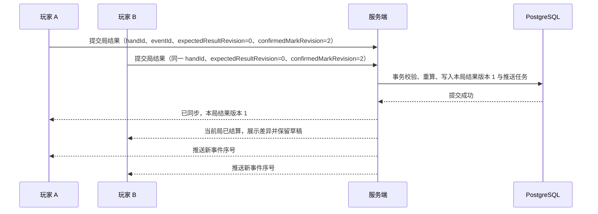
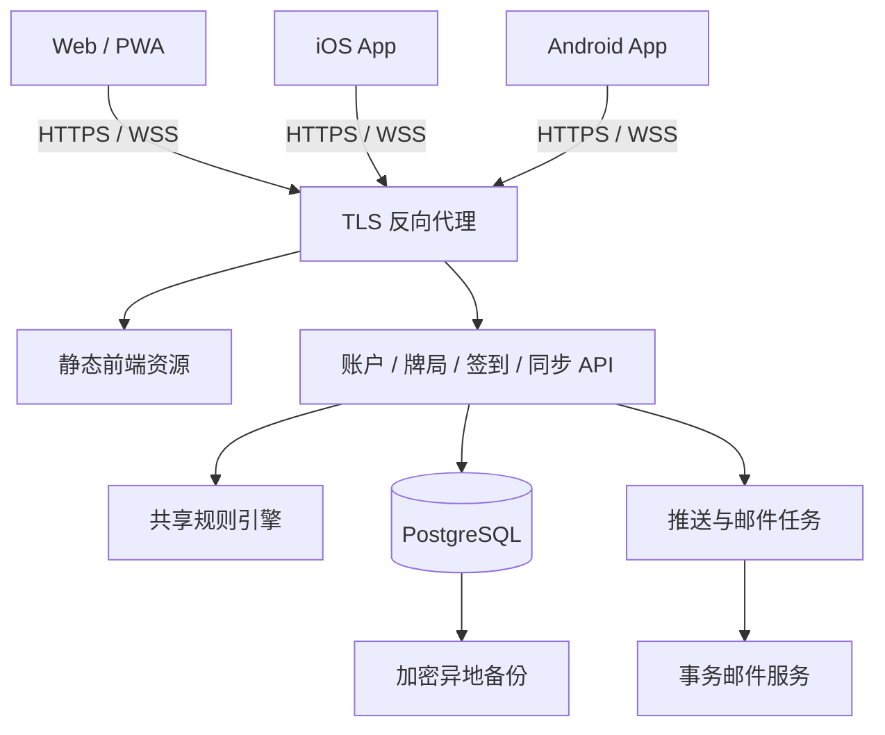

# 日麻线下记分与战绩管理：三端产品计划书

版本：1.2　研究日期：2026-10-19

适用范围：线下实体麻将，Web／iOS／Android，自有服务器。已纳入账户与安全、雀魂式视觉、全员共同录入、实时同步和开局二维码签到。

## 1. 项目建议

建议做成一个「线下麻将的随身记分桌」：熟手快速录入番符，新手按需使用手牌计算器；全员扫码签到后共同录入，三端实时更新；断网先保存本地记录，恢复网络后校验并同步到牌局及个人战绩。

推荐独立建立产品工程，参考第一个仓库的记分流程和第二个仓库的计算器分层。三端共用计分规则、数据结构和主要界面；服务端负责身份、权限、最终账本与同步校验。

首个正式版本应包含完整账户生命周期、四麻与一套明确的三麻规则、可调整数值和个人规则模板、二维码签到、多人协作记分、离线恢复、历史战绩和三端安装包。自动识别手牌、角色养成、俱乐部赛事作为后续阶段。

本文中的工期、服务器规格、会话时长和性能指标均为规划建议，未经目标服务器实测。仓库结论来自固定提交的源码检查；未对两个上游项目做完整安全审计或全量正确性验证。

## 2. 两个仓库的研究结论

### 2.1 对比

| 维度 | markoo-1/richi-mahjong-score-tracker- | 1Computer1/riichi-tracker |
|---|---|---|
| 研究提交 | `b18ee2474b933e2ec8e5ee9704c8a6733f303a44` | `50b6d98df4261a8c81a15d16bfbea6b5d2a686d3` |
| 提交时间 | 2026-09-13，仓库提交记录时区 +08:00 | 2026-08-13，仓库提交记录时区 -04:00 |
| 产品重点 | 开桌、番符记分、对局记录 | 手牌计算器、方位记分盘、役种参考 |
| 技术结构 | HTML／CSS／原生 JavaScript | React／TypeScript／Vite，独立计算库 |
| 数据保存 | LocalStorage | Dexie／IndexedDB；偏好另有 LocalStorage |
| 四麻／三麻 | 均有实现 | 均有实现，三麻支付方式有选项 |
| 计算方式 | 手填番符／役满倍数 | 手牌输入及番符输入 |
| 离线 | 本地静态使用 | PWA 与本地数据库 |
| 云端能力 | 所查源码未见账户、API 或多设备同步 | 所查源码未见账户后端或云同步服务 |
| 部署 | 静态站点 | Docker 构建后由 Nginx 提供静态文件 |
| 应用许可证 | MIT | AGPL-3.0-only |
| 适合借鉴 | 快速录入、局次流程、结果记录 | 计算器输入、规则配置、数据适配层 |

依据：[第一个项目 README](https://github.com/markoo-1/richi-mahjong-score-tracker-/blob/b18ee2474b933e2ec8e5ee9704c8a6733f303a44/README.md)、[第二个项目 package.json](https://github.com/1Computer1/riichi-tracker/blob/50b6d98df4261a8c81a15d16bfbea6b5d2a686d3/package.json)、[第二个项目数据库实现](https://github.com/1Computer1/riichi-tracker/blob/50b6d98df4261a8c81a15d16bfbea6b5d2a686d3/src/data/dexie/db.ts)、[第二个项目 Dockerfile](https://github.com/1Computer1/riichi-tracker/blob/50b6d98df4261a8c81a15d16bfbea6b5d2a686d3/Dockerfile)。

### 2.2 影响产品决策的具体发现

**第一，25 符存在需要修正的计算路径。** 第一个仓库在单人荣和、多人荣和和自摸中均出现对输入符数统一向上取整到十的逻辑。以无本场、无供托的子家 2 番 25 符荣和为例，该公式得到 2,000 点，保留七对子 25 符时应为 1,600 点。本次已按源代码公式复算；这不是一次完整浏览器回归测试。新引擎必须区分「原始符明细」和「已结算符数」，七对子独立处理。[源码计算路径](https://github.com/markoo-1/richi-mahjong-score-tracker-/blob/b18ee2474b933e2ec8e5ee9704c8a6733f303a44/enhanced_script.js#L1124)、[七对子规则来源](https://tenhou.net/man/index.html)。

**第二，多人荣和的分配顺序需要写进规则。** 第一个仓库按玩家数组收集胜者，并把供托交给首位胜者。新产品需要显式定义放铳者之后的座次优先顺序、本场分配及三家荣和处理，不能依赖数组或点击顺序。[多人荣和实现](https://github.com/markoo-1/richi-mahjong-score-tracker-/blob/b18ee2474b933e2ec8e5ee9704c8a6733f303a44/enhanced_script.js#L1579)。

**第三，第二个仓库的本地保存不等于长期账户战绩系统。** 其 `Game` 类型主要保存当前局次、分数、立直、本场与规则设置；新产品仍需增加稳定玩家 ID、逐局事件、历史修订、成员权限和云端统计。[Game 类型](https://github.com/1Computer1/riichi-tracker/blob/50b6d98df4261a8c81a15d16bfbea6b5d2a686d3/src/data/interfaces.ts#L20)。

**第四，应用许可证与计算库许可证不同。** 第二个应用的许可证为 AGPL，但其锁文件实际引用的 `1Computer1/riichi` 计算库提交 `bd950f2c3cf34cbcc9cb304d5f0702c49f8076ac` 标注 MIT。可以把该库作为独立评估对象，核查依赖、保留许可证、增加适配层和规则测试；不要把应用中的 AGPL 代码或素材当作 MIT 一起复制。[应用依赖锁定](https://github.com/1Computer1/riichi-tracker/blob/50b6d98df4261a8c81a15d16bfbea6b5d2a686d3/package-lock.json#L8103)、[计算库许可证](https://github.com/1Computer1/riichi/blob/bd950f2c3cf34cbcc9cb304d5f0702c49f8076ac/LICENSE)。

建议默认保留未来产品许可选择的空间，独立实现界面、账户和牌局管理。若决定直接改造 AGPL 应用，需要按适用条款履行源码提供及分发义务；网络服务的对应源码要求应单独确认，不能简单理解为「有服务器就能闭源部署」。[GNU AGPL 说明](https://www.gnu.org/licenses/gpl-howto.en.html#why-affero-gpl)。

## 3. 使用场景与功能范围

### 3.1 核心流程

1. 打开应用，继续上次牌局，或新建四麻／三麻牌局。
2. 选择四麻／三麻预置或「我的模板」，按需调整受支持的规则数值；可仅用于本桌，或命名保存为私人模板以供以后直接应用。确认座次后，房主展示签到二维码。
3. 同桌成员扫码，登录或建立本次临时访客身份，认领座位并确认到场；房主核对全员名单后开局。所有参赛成员都能录入。
4. 牌局中记录立直、自摸、荣和、流局；提交前预览每个人的增减及下一局状态。
5. 发现错误时可修订尚无后续依赖的最近一局；更早的争议保留原因和版本，待人工核对，不自动改写后来实际打过的局。
6. 结束牌局，展示原点数、顺位、马点与头名赏；区分已结算、全员核对和存在争议的状态。
7. 登录后同步至账户，按规则模板查看个人与同桌战绩。

本产品记录的是局结果和分数变化。没有逐巡录入时，不能称为可还原全部摸打过程的完整牌谱，也不能计算没有采集依据的副露率、振听或牌效指标。

### 3.2 功能优先级

| 阶段 | 功能 | 完成标准 |
|---|---|---|
| P0／首发 | 四麻、三麻手动番符记分 | 规则版本固定，支付明细和局次推进正确 |
| P0 | 可调规则与个人模板 | 可改受支持数值、预览结算、保存／更新／复制／归档私人模板，三端同账户可复用；历史牌局规则不变 |
| P0 | 东风／半庄、立直、荣和、自摸、流局 | 正常结束、连庄、供托与终局结算连贯 |
| P0 | 账户与安全中心 | 注册验证、登录、找回、设备撤销、导出与注销可用 |
| P0 | 二维码签到 | 3／4 人各自认领座位并确认；房主核对后开局 |
| P0 | 多人记分与实时同步 | 全员可录入；在线成员目标 1 秒内看到变化；同局只结算一次 |
| P0 | 记分权限与最近局纠错 | 参赛成员可写、旁观者只读；仅无后续依赖的最近局可修订，变更可追溯 |
| P0 | 离线草稿与联网恢复 | 已开局成员的未发送输入留本机；联网后重新校验，冲突由人处理；纯离线牌局不冒充已签到云端牌局 |
| P0 | Web、iOS、Android | 同一测试牌局在三端结果一致 |
| P0 | 基础战绩 | 对局数、顺位分布、平均顺位、总竞技分、局结果列表 |
| P0 | 原创麻将主题 | 大厅、牌桌、结算、战绩和账户具有一致视觉 |
| P1 | 手牌辅助算番算符 | 合法性检查、役种／符明细、多种拆解择优、可解释支付 |
| P1 | 特殊规则与历史修订 | 经专项测试的包牌、流局满贯、罚符模式、较早局重算与更多家规 |
| P1 | 熟人牌友与分组 | 邀请、成员管理、组内战绩；私密为默认 |
| P2 | 俱乐部与赛事 | 多桌、赛季、裁判复核及统一赛事规则 |
| P2 | OCR／图像识别 | 独立评估识别成本，所有识别结果经用户确认 |
| P2 | 原创角色／桌布扩展 | 美术资源、性能和许可明确后实施 |

P0 对特殊牌局提供经房主复核的「人工裁定」：明确各座位点数变动、原因和参与者确认，保留事件与守恒检查；不把尚未支持的包牌、流局满贯或诈和处罚伪装成自动算分。默认规则关闭未实现的选项。

## 4. 规则与计分设计

### 4.1 先确定规则版本

日麻存在不同规则体系。每个牌局开局时必须固定 `rulesetSnapshot + rulesHash + engineVersion`；使用已保存模板时再记录其 `rulesetVersion`，仅用于本桌的临时配置可以没有模板版本。修改个人模板不能改变历史牌局。

首发预置「四麻国际竞技参考 v1」与「三麻常见玩法参考 v1」，并保留「四麻家规 v1」「三麻家规 v1」作为可选起点。前者以 WRC 2025、EMA 2025 官方规则为对照来源，后者以天凤三麻规则说明等公开来源为对照；必须在阶段 A 逐项核对实际配置、列明差异，未核对完成前不能标作 WRC／EMA／天凤／雀魂兼容模板。三麻没有可直接照搬的国际统一规则，不把「常见玩法参考」包装成国际标准。视觉参考雀魂不代表默认规则已经与雀魂完全一致。

WRC 有 2025 版规则；EMA 官方页列有 2025 版及其生效说明，新版包含切上满贯、连风雀头符等变化。不能把某一时期记忆中的规则写成唯一标准。[WRC 官方规则入口](https://www.worldriichi.org/wrc-rules)、[EMA 官方规则与修订](https://mahjong-europe.org/portal/index.php?Itemid=166&id=30&option=com_content&view=article)。

WRC 2025 还允许不足 1,000 点立直、负分继续，以及终局供托不自动分配；这些与下文家规示例的限制不同。若未来把预置模板标为「WRC 2025 兼容」，必须先在引擎、账本和终局竞技分中实现并验证这些差异；仅使用相同起始点与马点并不构成兼容。[WRC 2025 规则原文](https://static1.squarespace.com/static/634a7884c297a25f06589b79/t/6834d67360e19c1da6c0d12c/1748293243651/WRC%2BRules%2B2025.pdf)。

### 4.2 建议默认模板

下表是本产品拟定的家规示例，不声称是某平台的完整复刻。预置的两套参考模板与这两套家规模板分别列示，不能把家规示例直接改名为国际规则。所有影响分数的设置开局前展示，开始记分后锁定。

两套**参考预置的初始参数草案**如下；属于待阶段 A 验证的种子配置，不是已运行的软件数据：

| 模板 | 初始参数草案 | 来源与待核对差异 |
|---|---|---|
| 四麻国际竞技参考 v1 | 30,000 起／30,000 返；马点 +15／+5／−5／−15；无赤宝牌；流局罚符总额 3,000；每本场总额 300；单人荣和优先 | 核心参数对照 WRC 2025；低点立直、负分续行、同点马点分摊、终局供托及比赛处罚须逐项实现，未完成前只称「参考」 |
| 三麻常见玩法参考 v1 | 35,000 起／40,000 返；马点 +20／0／−20；自摸损；流局罚符总额暂定 2,000；每本场总额 200 | 起始／返还点、马点及牌集合对照天凤三麻说明；2,000 流局罚符是待阶段 A 核对的产品候选值，不能称天凤或雀魂官方模板；拔北、宝牌、终局和支付仍须逐项核对 |

四麻参考模板可以使用已验证的 P0 子集，但界面必须列出与 WRC 的差异；若差异涉及无法正确结算的情形，先禁用对应模式或暂不开放该预置模板。三麻参考模板按其自身配置验证，不借用四麻引擎默认值。[WRC 2025 规则原文](https://static1.squarespace.com/static/634a7884c297a25f06589b79/t/6834d67360e19c1da6c0d12c/1748293243651/WRC%2BRules%2B2025.pdf)、[天凤三麻说明](https://tenhou.net/man/index.html)。

| 规则项 | 四麻家规 v1 建议 | 三麻家规 v1 建议 |
|---|---|---|
| 起始点／返还点 | 25,000／30,000 | 35,000／40,000 |
| 马点 | +20／+10／−10／−20 | +20／0／−20 |
| 头名赏 | 20 个竞技分 | 15 个竞技分 |
| 食断／赤宝牌 | 开启；每门一种赤五 | 开启；筒索各一种赤五 |
| 切上满贯 | 关闭；可在另一个模板开启 | 同左 |
| 累计役满 | 13 番及以上按单役满 | 同左 |
| 复合役满／双倍役满 | 复合开启；特殊双倍默认关闭 | 同左 |
| 重复役牌雀头 | 连风雀头 4 符 | 按指定场风与自风判断 |
| 自摸支付 | 四人常规分担 | 默认自摸损；补偿方式另建模板 |
| 本场 | 荣和每本 300；自摸每位付款者每本 100 | 荣和每本 200；自摸每位付款者每本 100，总额同为每本 200 |
| 荒牌流局罚符总额 | 3,000；全听／全不听不转账 | 建议 3,000；允许另设 2,000 家规模板 |
| 多人荣和 | 双响成立；三家荣和按途中流局 | 两位胜者成立 |
| 双响供托／本场 | 供托给放铳者之后座次最近的胜者；本场分别计入每位胜者 | 同左；显式说明这是本产品家规 |
| 飞人结束 | 分数小于 0 结束，0 点继续 | 同左 |
| 同点顺位 | 按初始座次优先顺序；结算页解释 | 同左 |
| 流局满贯／包牌／诈和罚符 | 首发自动处理关闭，必要时人工裁定；罚符竞技分不自动计入 | 同左 |

三麻荒牌流局罚符如采用 3,000 点：一人听牌时从另两位各收 1,500 点；两人听牌时各从未听牌者收 1,500 点。2,000 点模板对应每位付款者／受款者 1,000 点。全听或全不听时均不转移。每个模板的荣和与自摸本场总额必须一致；上述每本 200 点是本产品三麻家规建议，不冒称平台通用规则。

三麻应独立定义牌集合、拔北、北的役牌属性、宝牌循环与支付策略；它不是简单删除一个玩家。天凤手册可核实三麻缺少二至八万、不能吃、拔北等差异，具体模板仍需逐项对照。[天凤三麻说明](https://tenhou.net/man/index.html)。

#### 可调整数值与保存模板（P0）

开桌页按「预置模板／我的模板 → 调整数值与开关 → 查看逐项规则和支付预览 → 仅用于本桌或保存到我的模板 → 确认签到」操作。已登录用户的私人模板保存在服务端并跨三端同步；访客可使用预置模板和本桌临时调整，但须注册／登录后才能长期保存到「我的模板」。预置模板只读，点「复制并编辑」才生成私人模板。模板列表提供名称、三麻／四麻、关键差异、最近使用时间和「直接应用」；常用模板可设为该人数的开桌默认值。

| 类别 | 首发允许调整 | 校验与说明 |
|---|---|---|
| 比赛点数 | 起始点、返还点、马点、飞人结束开关及终局目标点 | 输入点数须为整数且符合计点单位；头名赏按起始点、返还点和马点自动计算并展示，使竞技分总和为零 |
| 局次 | 东风／半庄、末局连庄与延长上限 | 最大局数必须覆盖所选场次；终局条件不能形成无限循环 |
| 局内支付 | 荒牌流局罚符总额、本场每位付款额 | 服务端按人数和听牌人数分摊；每笔支付为合法点数单位且总账守恒；本场荣和总增额等于自摸各付款者增额之和；立直棒仍固定为 1,000 点 |
| 已实现的规则开关 | 食断、赤宝牌数量、切上满贯、累计役满、三麻自摸损／已实现的补偿模式、双响处理 | 只开放已进入规则引擎和回归样本的选项；未实现的包牌、流局满贯、自动诈和罚符不显示为可用开关 |

三麻流局罚符可把 `3,000` 调为 `2,000`，预览必须同时显示「一人听牌」与「两人听牌」的每座支付明细。规则字段采用带版本的受控表单和服务端白名单校验，不能输入任意公式或脚本。人数是模板类型，不能把四麻模板直接改成三麻；应选择三麻起点再调整。

「仅用于本桌」只改这桌的待开局快照，不创建私人模板；「保存为新模板」要求命名并保存完整配置；编辑已有私人模板时生成新的不可变版本，旧版本仍供历史牌局引用。保存不自动改动其他准备中牌局；用户必须在该桌明确点「应用新版本」。删除操作采用归档，从个人列表隐藏，但不删除历史牌局的规则快照。旧客户端或规则引擎不支持的模板显示差异并阻止开始记分，不能静默套用近似值。

阶段 A 必须为四麻、三麻两个参考预置模板编写来源对照表：官方来源、规则年份、配置项、已实现状态、人工确认的计分样本和与来源不同之处。完成核对前，产品页面只显示「参考／待验证」，不使用「官方」「国际统一」等标签。[WRC 官方规则](https://www.worldriichi.org/wrc-rules)、[EMA 官方规则](https://mahjong-europe.org/portal/index.php?Itemid=166&id=30&option=com_content&view=article)、[天凤三麻说明](https://tenhou.net/man/index.html)。

### 4.3 点数计算

以四麻常规计点为基础，未达到限界时：

```text
基本点 B = 符 × 2^(番 + 2)
R100(x) = 向上取整到 100 点

子家荣和：放铳者支付 R100(4B)
庄家荣和：放铳者支付 R100(6B)
子家自摸：庄家支付 R100(2B)，其他子家各支付 R100(B)
庄家自摸：其他三家各支付 R100(2B)
```

逐位付款者取整后再汇总。常规满贯基本点为 2,000；6–7 番为 3,000；8–10 番为 4,000；11–12 番为 6,000；役满为 8,000。普通手的满贯封顶、切上满贯和累计役满由模板决定。公式与标准点表需双向校验。[WRC 官方计分表入口](https://www.worldriichi.org/wrc-rules)。

必须单独覆盖的边界：

- 七对子固定 25 符；平和自摸 20 符；门前荣和通常加 10 符。
- 刻子／杠子、明暗、幺九、雀头和等待形影响符数；自摸与特殊符规则由模板决定。
- 宝牌、赤宝牌、里宝牌不单独构成有效和牌役。手动番符模式必须明确由记分者确认至少一役；仅凭总番数不能自动验证这一点。
- 手牌计算器必须输入和牌张、副露、场风、自风及条件役；振听、一发是否中断等依赖过程的信息，需要用户声明。
- 三麻的自摸损与补偿支付必须有独立算法和测试，不直接把四麻总额除以二。
- 包牌只作用于该模板指定的责任部分；复合役满、放铳与本场的分担单独定义。

### 4.4 立直、本场与局次状态机

局中立直先记录为所有成员可见的「待确认标记」，不立刻扣点。局末提交结果时，录入者逐座确认哪些立直已成立；同一结算事务将成立者各扣 1,000 点并转入供托，再按胜者／流局规则处理供托。宣言牌被荣和的立直标记记为未成立，不扣棒；流程不要求现场为每次宣言另点一次“成立”。正在录入结算的人若遇到其他成员新增／取消标记，须看到新的支付预览并重新确认。

标记时先核验该座位不少于 1,000 点，结算时再由服务端复核。每局每座最多一份有效标记；最终「已成立／未成立」和操作者写入结果快照，后续统计与修订依据该快照。供托是独立账本账户，不能从和牌付款者重复扣除。

| 结果 | 庄家处理 | 本场处理 | 供托处理 |
|---|---|---|---|
| 庄家和牌 | 连庄 | +1 | 按和牌分配 |
| 子家和牌 | 轮庄 | 归 0 | 按和牌分配 |
| 荒牌流局且庄家听牌 | 连庄 | +1 | 保留 |
| 荒牌流局且庄家不听 | 轮庄 | +1，不能因轮庄清零 | 保留 |
| 模板允许的途中流局 | 连庄 | +1 | 保留 |
| 诈和／裁定 | 首发仅支持「本局作废、原局重打」或经房主复核的人工裁定 | 作废不计普通流局本场；若重打，按模板明确本场 | 当局标记不扣棒；先前供托照常保留 |

本表为拟定家规的正常推进；终局条件在本局扣付立直棒、支付和牌／罚符、本场及供托后统一判断。东风与半庄需分别定义最后一局、和了止め、听牌止め、延长场和最大局数。建议：末局庄家满足目标点且独占第一时允许结束；否则按模板续行，延长到下一个风圈并设硬上限。立直须有至少 1,000 点才可声明，0–900 点不可进入「已成立」集合；负分结束在本局完整结算后判断，0 点继续。同点和供托未分配时的判断顺序必须有用例。

普通局内保持：

```text
全部玩家持点之和 + 场上供托点数 = 初始总点数
```

罚分若转入外部处罚池，必须把该池纳入账本守恒。局终后竞技分另算，不反写为玩家持点。

### 4.5 终局结算

```text
个人竞技分 = (最终持点 − 返还点) / 1000 + 马点 + 分配到的头名赏
```

本局结算后，先用玩家实际持点判断是否飞人、末局目标点及延长场；仍在桌上的供托不计入目标点，也不能为判断是否终局先行分配。确定牌局结束后，若仍有供托，再按分配前的持点定暂定首位；同点用开局固定的座次优先顺序。将供托从供托账户转给该座位，再以更新后的持点计算最终顺位和竞技分；保留一位小数。终局不得凭空销毁供托，也不得将其同时计入胜者点数与头名赏。以四麻最终分数 `40,000 / 30,000 / 20,000 / 10,000` 为例，使用上述模板得到 `+50 / +10 / −20 / −40`，总和为 0。头名赏只计一次。

## 5. 账户管理与权限

### 5.1 账户生命周期

| 功能 | 首发要求 |
|---|---|
| 注册 | 邮箱＋密码；验证邮箱后启用云同步；昵称与登录标识分离 |
| 登录 | 支持密码管理器；统一失败提示；异常尝试限速 |
| 本地使用 | 未登录可记本地牌局；界面持续说明尚未备份到云端 |
| 找回密码 | 单用途、短时、单次有效的重置凭证；完成后撤销旧会话并通知用户 |
| 修改邮箱 | 近期重新验证身份；确认新邮箱；通知旧邮箱；高风险情况额外验证 |
| 修改密码 | 校验当前凭证；提供退出其他设备；高风险重置默认退出全部设备 |
| 多因素认证 | 首发不开放平台管理员后台；普通账户 TOTP 与恢复码列 P1，部署维护账号使用独立强认证 |
| 设备管理 | 显示设备标签、最近活动、当前设备；单设备和全部设备退出 |
| 账户状态 | 未验证、正常、受限、停用、注销处理中、已删除；每个状态定义可用操作 |
| 数据导出 | 导出自己的资料与获准查看的对局；导出链接短时有效 |
| 注销 | App 内和网页均可发起；再次验证；撤销会话并执行数据删除计划 |

建议使用自托管 Better Auth 承担邮箱密码、会话和 TOTP；牌局授权由业务服务实现。其官方文档具备上述基础功能，但还需通过 Capacitor 真机、会话撤销和恢复流程的技术验证。[Better Auth 功能](https://better-auth.com/docs/introduction)、[会话管理](https://better-auth.com/docs/concepts/session-management)、[双因素认证](https://better-auth.com/docs/plugins/2fa)。

第三方 Apple／Google 登录和 Passkey 可在 P1 增加。账号绑定需重新认证，不能仅凭相同未验证邮箱自动合并账户。

### 5.2 玩家身份与账户的关系

`User` 是能登录的长期账户；`GuestSession` 是服务端签发且仅用于该牌局的临时身份；`PlayerProfile` 是战绩归属；`MatchSeat` 是某一场的座位。临时身份有受限会话、权限及可审计的操作者 ID，不只是一个昵称。扫码后可先用访客身份入桌，不必当场注册。

座位认领在签到时完成，并经房主确认。访客升级为长期账户需证明持有该访客会话，并验证目标账户，随后明确选择迁移哪些战绩；丢失会话走房主与目标用户核对流程，不按昵称自动归并。已绑定座位转交给其他账户需双方确认或经过受审计的争议流程。

### 5.3 权限矩阵

| 操作 | 未入桌用户 | 已签到参赛成员，含临时身份 | 旁观者 | 房主 | 平台管理员 |
|---|---|---|---|---|---|
| 查看私密牌局 | 不可 | 本牌局 | 获授权的本牌局 | 自己管理的牌局 | 默认无批量读取权限 |
| 记录任一座位的立直／局结果 | 不可 | 可 | 不可 | 可 | 不直接改分 |
| 发起纠错／争议 | 不可 | 可 | 只读 | 可 | 可处理支持工单 |
| 更正局中立直标记／无后续依赖的最近局 | 不可 | 可更正标记；最近局修订需复核并留痕 | 不可 | 可复核，注明原因 | 不直接改分 |
| 较早局／已结算牌局争议 | 不可 | 可提议并标记争议；P0 不自动重写后续局 | 不可 | 组织核对，通知全员 | 通过受审计流程 |
| 邀请／移除成员与座位确认 | 不可 | 可出示邀请，不自行批准 | 不可 | 可 | 支持流程内可处理 |
| 改已开局规则 | 不可 | 不可 | 不可 | 建立新版本牌局 | 不直接改历史 |
| 删除账户 | 仅本人 | 仅本人 | 仅本人 | 仅本人 | 可停用，删除走专用流程 |

房主负责开桌与成员管理，不独占记分。参赛成员默认均可提交，不需要每局等待房主批准。签到二维码与只读分享链接使用不同权限范围。房主移除已参赛者后，对方已形成的个人战绩保留规则需明确，不能用踢人抹去比赛事实。

私人模板仅本人可查看、修改和归档；系统预置只读，所有人可复制。只有房主／共同主持能在开局前把模板或临时调整应用到本桌；任何已签到成员因此必须重新确认规则。开局后所有人只能查看该桌规则快照，不能修改。

授权在服务端按账户或临时会话、牌局成员关系、角色与状态逐项校验。不可仅隐藏按钮，也不可因为知道 `matchId` 就能读取或修改。[OWASP 授权原则](https://cheatsheetseries.owasp.org/cheatsheets/Authorization_Cheat_Sheet.html)。

### 5.4 账户安全页与管理后台

用户侧首发设置包含：基本资料、登录与密码、设备会话、隐私与分享、数据导出、注销账户；双重验证设置在 P1 开启时补充。设备退出、修改邮箱和注销均展示实际影响；保存失败不能显示成功。

首发运维使用受限部署命令和审计日志处理封禁、备份与故障，不提供可浏览全站私密牌局的管理员后台；操作人员使用独立强认证。完整后台、争议工单、多级角色和管理员 TOTP 随 P1 后台一并验收。普通客服不提供冒充用户登录，不查看密码或 MFA 密钥，不直接覆盖牌局分数。

## 6. 安全技术与数据保护

### 6.1 认证与会话约束

以下时长和阈值为拟定初值，上线前根据实测调整：

- 密码建议 15–128 字符，允许粘贴和长口令，拒绝常见泄露密码。首发优先使用 Better Auth 的 scrypt 实现；在阶段 A 核验实际参数并按目标服务器压测，达不到 OWASP 基线时显式接入经验证的 Argon2id hash／verify。Argon2id 不是 Better Auth 默认值。密码验证进入有并发上限的工作队列，不阻塞实时事件循环；规格与登录高峰实测后才能承诺容量。[密码存储建议](https://cheatsheetseries.owasp.org/cheatsheets/Password_Storage_Cheat_Sheet.html)、[Better Auth 安全说明](https://better-auth.com/docs/reference/security)。
- Web 使用同源 API 和 `HttpOnly + Secure + SameSite` 会话 Cookie；写请求进行 CSRF／Origin 验证。认证令牌不放 LocalStorage、IndexedDB、URL 或日志。[OWASP 会话管理](https://cheatsheetseries.owasp.org/cheatsheets/Session_Management_Cheat_Sheet.html)。
- App 通过受控原生网络适配器携带会话凭证，持久化放 iOS Keychain／Android Keystore 支撑的安全存储；不使用 Capacitor 普通 Preferences 保存凭证。Better Auth 的 Bearer 插件可作为接入方案，需专项验证。[Bearer 插件](https://better-auth.com/docs/plugins/bearer)。
- 三端实时连接统一先通过已认证的 HTTPS `POST /api/ws-ticket` 获取短期一次性票据，WebSocket 打开后第一帧发送票据；服务端在验票前不推送私密内容，约 5 秒内未认证即断开，并限制未认证连接数。票据仅供建立连接，30 秒到期、用后即失效，绑定原会话与允许订阅的牌局；只存校验值，不放 URL、子协议字段或日志。浏览器原生 `WebSocket` 构造器不能添加任意认证头，因此移动端和网页均需真机验证此握手。[WebSocket 构造器](https://developer.mozilla.org/en-US/docs/Web/API/WebSocket/WebSocket)。
- 首发采用可在数据库撤销的不透明会话，避免另外自制一套长期 JWT／刷新令牌协议。记住登录的会话建议最长 30 天；敏感操作要求最近 5 分钟内重新认证；管理员会话更短。
- 对写操作通过认证组件读取权威会话，并在业务事务内复核账户与成员状态；首发关闭会掩盖撤销状态的 Cookie／二级会话缓存。踢设备、封禁、注销成功后，之后开始的在线受保护请求应失败，WebSocket 按撤销事件关闭或停止订阅；已经通过校验且正在提交的请求可能完成，界面应说明这一边界。具体时序用真机与并发测试验证。
- 普通用户 TOTP 列为 P1；首发必须完成邮箱验证、找回密码、会话撤销和自助账户注销。启用 MFA 后，TOTP 密钥加密保存且密钥与数据库分离，恢复码单次使用并以不可逆校验值保存；密码重置流程不能绕过已启用的 MFA。[MFA 建议](https://cheatsheetseries.owasp.org/cheatsheets/Multifactor_Authentication_Cheat_Sheet.html)。
- 注册、登录和找回密码避免泄露某邮箱是否存在；按账号与来源组合限速，不能仅依赖 IP 或永久锁定账户。[认证建议](https://cheatsheetseries.owasp.org/cheatsheets/Authentication_Cheat_Sheet.html)。
- 重置链接建议有效 15 分钟、单次消费、绑定操作目的；不接受任意回跳地址。邮件发送建议间隔至少 60 秒，并设置小时额度，防止轰炸。[密码找回建议](https://cheatsheetseries.owasp.org/cheatsheets/Forgot_Password_Cheat_Sheet.html)。

### 6.2 牌局与应用安全

| 风险 | 实施要求 |
|---|---|
| 越权读写牌局 | 每个 API／订阅校验成员与角色；导出和附件同样校验 |
| 伪造分数 | 客户端提交局结果事件；服务端按固定规则重算，拒绝直接覆盖总分 |
| 重复提交 | `clientEventId` 幂等；相同 ID 但不同内容拒绝；数据库事务写入 |
| 多人同时改分 | 每局唯一有效结果；提交须确认最新立直标记与支付预览；冲突保留草稿 |
| 邀请码猜测 | 长随机令牌、有效期和使用范围；短码仅用于查找并需房主确认 |
| XSS／昵称注入 | 昵称、备注按纯文本渲染；CSP；不拼接未转义 HTML |
| 上传滥用 | 首发预设头像；未来上传限制大小、格式和像素，重编码并移除元数据 |
| 令牌泄露 | 日志脱敏、重置页不加载第三方追踪、私密响应不进入公共缓存 |
| CSV 注入 | 导出内容以 `= + - @` 等开头时按安全文本处理 |
| 滥用导出／批量接口 | 分页、大小上限、频率控制；签名下载链接建议 10 分钟失效 |
| 客户端篡改 | 不信任客户端角色、时间、校验和；核心授权与计分在服务器复核 |

客户端共享计分包可以用于即时预览和离线计算，但它不构成服务器信任依据。应用能校验账本一致性，不能证明线下玩家申报的和牌或听牌事实真实发生；使用参与者核对与争议标记表达这一边界。

### 6.3 隐私、注销与审计

默认私密，仅收集邮箱、昵称、必要会话信息及牌局数据。好友通过邀请码建立关系，不上传通讯录。公开分享必须由用户主动开启，可过期和撤销，分享视图不暴露邮箱或安全信息。

注销建议即时撤销会话并停用账户，在 30 天内完成清理；具体时限是产品承诺草案。删除凭证、邮箱、个人配置、未分享私人资料，并清除共享牌局中的账户关联、昵称快照及备注中的个人信息。共享局结果只有在真正去除可识别关系且符合适用要求时才保留；否则删除相应信息，不能把改名当成完成注销。

App 内提供注销入口，网页也提供可执行申请入口。Apple 和 Google Play 均有相应账户删除要求，提交商店前按当时规则复核。[Apple 账户删除要求](https://developer.apple.com/support/offering-account-deletion-in-your-app/)、[Google Play 删除要求](https://support.google.com/googleplay/android-developer/answer/13327111?hl=en)。

审计记录包括操作者、目标、操作类型、发生时间、请求标识、修订原因及变更版本；不保存密码、验证码、完整令牌。安全日志建议保留 90 天并限制访问，最终期限按部署地区及业务需求确定。业务审计与用户身份分离，以便注销时清除身份关联。

服务器备份加密并异地保存，密钥单独保管。恢复时重新执行删除清单，避免把已注销账户从旧备份恢复。远程退出不能抹除已经断网的设备缓存；在线时清理账户缓存，离线设备必须在下次联网时失去同步权限，界面不得承诺远程彻底擦除。

## 7. 全员录入与实时同步

### 7.1 确定的协作模式

所有已入桌参赛成员都可以记录任一座位的立直标记、和牌与流局。立直标记同步给全桌，但直到本局结算才扣棒；服务端保存权威结果，通过 WebSocket 推送给本桌全部在线设备。首发就提供实时同步；蓝牙不承担同步传输。

在线目标为：正常网络下，从服务器接受记录到其他前台设备显示更新，95% 的事件在 1 秒以内。该数值为待压测的目标；断网、后台挂起和跨区域高延迟需显示真实连接状态。

操作记录展示「小林录入：东二局，阿青荣和，3 番 40 符」；同步状态区分提交中、已同步、待联网和有冲突。某成员开始填写结算时可广播不含私密凭证的短期「正在录入」提示，减少重复劳动；提示有过期时间，不是抢占锁，其他成员仍可录入。发起人明确看到服务器是否已接受。

### 7.2 同一局不会结算两次



必须同时实现三层保护：

1. 同一客户端重试使用原 `clientEventId`，仅返回之前结果，不再扣分。
2. 不同成员提交使用本局 `expectedResultRevision` 和已确认的 `confirmedMarkRevision` 检查；成员或旁观者变化不会无故让记分失败。数据库事务保证竞争时只有一个结果先被接受。
3. 每个 `handId` 仅有一个有效结果，防止晚到请求应用于下一局；P0 仅允许无后续依赖的最近局追加修订版本，较早局先记录争议。

立直标记更新持久化并提升局内标记版本，但不单独转点；同一座位只有一份当前标记。结算提交必须携带已确认的标记版本／摘要；如果其他成员刚改动标记，服务端返回新支付预览，由录入者重新确认，保留原输入。结算由本局唯一有效结果约束防重。两份和牌结果不能用“最后一次覆盖”自动处理；多人荣和必须在同一份结果中包含所有胜者。

### 7.3 断线、后台与离线记录

- 客户端持久化最近确认状态、事件游标和待提交队列；服务器分配单调递增序号。
- 网络恢复或 App 回到前台后，先拉取缺失事件，再校验待提交内容；序号断档时获取权威快照。
- 联网后按本局结果版本与立直标记版本重新校验离线草稿；如出现相关远端变更，显示新的支付预览或冲突，不静默合并账本。
- 两个人断网期间记录了同一局，保留双方草稿，展示差异，由成员确认或走纠错流程；不能承诺任意多人离线编辑都自动正确合并。
- WebSocket 消息可重复或丢失，客户端按事件 ID 去重。服务端把业务事件和待推送记录放在同一个数据库事务中，推送失败可重试。
- 不能把 WebSocket 心跳理解为人在现场；在线状态与到场签到是两个字段。
- 全桌完全无网时可以使用单设备「本地练习／草稿牌局」，不标记云端已签到或多人已核对。联网后若要转成正式共享牌局，需重新开桌、现场签到并逐局核对输入；首发不自动导入草稿为正式战绩。
- 被移除、会话已撤销或账户停用的设备，旧离线记录不能直接进入云端；内容保留为可导出的本地草稿。

多人协作依赖可达网络和服务端。蓝牙局域同步不是本期功能；服务器故障时已开局成员仍可保存本机草稿，恢复后按最新服务端状态逐条核对，不能承诺多台设备离线期间自动合并。

## 8. 开局二维码签到

### 8.1 已确认方案

用户已选择二维码。首发不要求蓝牙、不强制 GPS、不持续追踪位置。扫码是便利的到场确认方式，由各成员与房主共同确认，不能包装成精确距离认证。

开桌状态依次为：`准备中 → 签到中 → 全员就绪 → 对局中 → 已结算`。签到页展示玩家、座位、确认状态和规则摘要。

1. 房主选择三麻／四麻及规则，生成牌局与短时二维码。
2. 二维码打开 HTTPS 入桌页；安装 App 的设备可通过 Universal Links／App Links 打开同一牌局，未安装者直接使用网页。
3. 已登录者沿用账户；未登录者可建立仅本桌有效的访客会话，再认领座位。
4. 参与者确认「我已到场」与规则；房主核对真实在场者与名单。房主也占据自己的参赛座位。
5. 服务器确认有 3／4 个有效且已确认的座位，房主点击开始。开局后全部参赛成员可录入。

不强制每局重复签到。换人时重新认领并记录生效局次；已经开局的座位身份不能直接改成另一个账户覆盖历史。房主离线时，其他参赛成员照常记分。房主可在开局前指定一名共同主持，共同主持可处理换人、撤销邀请和转交管理，所有操作审计；若两位均不可用，成员管理等待其恢复，当前成员仍可记分。

### 8.2 二维码的安全与易用性

| 项目 | 设计要求 |
|---|---|
| 令牌 | 每桌保存一个可撤销的邀请活动及 generation；二维码携带牌局、活动、时间窗口和服务端 HMAC 校验值，不含邮箱或认证会话 |
| 有效期 | 页面每 60 秒按时间窗口生成新码，旧窗口结束后最多再接受 30 秒；仅人工重置、开局或撤销时更新数据库 generation／状态 |
| 使用方式 | 同一邀请活动可供本桌多人申请；按 `(match_id, principal_id)` 保证同一时刻至多一条待处理申请，重复扫码返回原申请 |
| 座位竞争 | 服务器保证同一座位只能有一位有效成员；重复扫码回到原座位 |
| 权限 | 扫码先申请入桌；到场确认和房主核对后成为参赛者；二维码本身不是登录凭证 |
| 防冒名 | 展示头像、昵称和短身份编号；一个已知账户在同一牌局只占一个座位 |
| 临时身份 | 服务端限制频率和额度；一个设备可创建多个身份的风险交由房主现场核对，不能假称已识别人身 |
| 无相机权限 | 允许输入房主提供的短时入桌码；同样要认领、确认和核对 |
| 共享链接 | 普通分享链接只读，不沿用签到令牌；入桌成功后清除地址中的秘密参数，日志脱敏 |
| 状态显示 | 「3/4 人已到场」「二维码已过期」「座位已被认领」，不显示虚构距离 |

二维码活动 ID 在轮换中保持不变；验证时按服务器时间、generation、HMAC 与活动状态核对，密钥只在服务端，禁止依赖客户端时钟。限流与房主现场核对同样必要。访客需保存仅本桌可用的恢复凭证；原设备／凭证丢失且邀请已关闭时，不能靠重新扫码冒领。房主与共同主持核对后可以签发受审计的一次性座位恢复凭证，同时撤销旧访客会话。

二维码可能被拍照转发，账号也不能证明持有人本人到场。因此「到场已确认」是参与者确认记录，不作为强反作弊证据，也不自动给予可信排名认证。

### 8.3 为什么首发不依赖蓝牙

Web Bluetooth 并不是所有主流浏览器都具备的通用能力；原生 App 的扫描与广播还涉及权限、前后台和机型差异。RSSI 可以辅助判断远近，但受环境影响，不能把一个阈值直接当成同桌或准确米数。[Web Bluetooth 支持与权限](https://developer.mozilla.org/en-US/docs/Web/API/Web_Bluetooth_API)、[Android 蓝牙权限](https://developer.android.com/develop/connectivity/bluetooth/bt-permissions)、[Apple 前后台广播限制](https://developer.apple.com/library/archive/documentation/NetworkingInternetWeb/Conceptual/CoreBluetooth_concepts/CoreBluetoothBackgroundProcessingForIOSApps/PerformingTasksWhileYourAppIsInTheBackground.html)、[Bluetooth SIG 技术说明](https://www.bluetooth.com/core-specification-6-feature-overview/)。

以后若扩展赛事，可另做可选近场核验，并标注核验方式及时间；当前不增加蓝牙、精确定位或后台扫描权限。同一 Wi-Fi／公网 IP 也不等于同桌，不替代签到确认。

## 9. 三端技术架构与自部署

### 9.1 推荐选型

| 层 | 建议 | 原因与边界 |
|---|---|---|
| UI | React＋TypeScript＋Vite | 适合牌桌状态、表单、战绩与共享组件；版本按开工时稳定组合锁定 |
| Web | 响应式页面＋PWA | 浏览器可直接加入；已缓存资源可离线打开 |
| iOS／Android | Capacitor，打包本地前端资源 | 共用界面和规则，通过原生适配获得扫码、安全存储与分享能力 |
| 服务端 | TypeScript＋Fastify 模块化单体 | 计分、牌局、账户、签到、同步和后台任务在一个部署单元中分模块 |
| 认证 | Better Auth＋PostgreSQL | 复用认证组件；业务授权自己定义并测试 |
| 数据库 | PostgreSQL | 事务、唯一约束、事件序列与统计查询 |
| 本地存储 | Web 使用 IndexedDB／Dexie；App 评估 SQLite 适配 | 大量历史与待提交队列不放 LocalStorage；平台库需核验维护和许可 |
| 实时 | WebSocket 推送＋HTTP 命令接口 | 命令易于幂等和审计；实时通知可重发与补拉 |
| 规则引擎 | 独立纯 TypeScript 包 | 浏览器、App、服务端使用相同版本，服务端最终复核 |
| 发布 | Docker Compose＋Caddy 或现有 Nginx | 自有服务器可运维；TLS 自动续期或接入现有证书流程 |

Capacitor 是把 Web 技术用于原生应用的运行时，仍要分别配置和测试 iOS／Android 工程。它不能免除签名、商店审核、系统权限和真机测试。[Capacitor 官方文档](https://capacitorjs.com/docs)。

如果团队已有 Flutter 经验，可采用 Flutter 三端，但 TypeScript 计算库要重新封装或另做引擎实现；如果未来发展成强原生动画与复杂蓝牙产品，可评估 React Native。基于当前二维码与记分需求，优先采用 Web 共用程度高的方案。游戏氛围主要由原创美术与 2D 交互实现，首发无需引入完整游戏引擎。

### 9.2 部署关系



首期单台服务器可作为部署验证起点。2 vCPU／4 GB 仅用于测试安装、SSD 与备份的初步预算，不代表可承载目标桌数；密码哈希、邮件任务、数据库和 WebSocket 同机时尤其要限制哈希并发并测量 CPU、内存与推送尾延迟。开发构建在 CI 或开发机进行。正式容量由目标负载实测决定。先不用 Kubernetes，也不因有实时同步就先引入微服务；横向扩容时再增加共享消息分发与集中限流。

### 9.3 关键数据对象

| 对象 | 必须保存的信息 |
|---|---|
| User／GuestSession／Session | 身份、状态、验证状态、会话到期与撤销；访客身份权限范围 |
| PlayerProfile／MatchSeat | 战绩归属、初始座次、昵称快照、认领历史 |
| Match／MatchMember | 房主、角色、牌局状态、版本、规则快照、开局与结束时间 |
| RulesetVersion | 人数、计分参数、连庄／终局条件、特殊规则、引擎版本 |
| Invitation／CheckIn | 固定邀请活动与时间窗、过期时间、座位、确认方式、确认人、服务器确认时间 |
| Hand／HandResult／HandSeatOutcome | 独立局 ID、局次、本场、全座位立直与听牌状态、胜者／放铳者、有效结果版本 |
| MatchEvent／LedgerEntry | 事件 ID、作者、顺序、输入、支付明细、变更前后版本 |
| Revision／Dispute | 最近无依赖局的修订、较早局的争议与人工核对、理由及复核结果 |
| Outbox／SyncCursor | 待推送事件、处理状态与重连游标 |
| AuditLog／DeletionJob | 安全与管理审计、账户删除执行与恢复后的清理标记 |

所有点数使用整数；竞技分存整数最小单位或精确数值类型，避免浮点误差。座位、活跃结果、事件 ID 由数据库约束防重。原始事件与审计追加保存，当前分数和统计是可重建视图；不把对局保存成一个可以被任意覆盖的大 JSON。

完整字段、表关系、外键与索引、多人提交事务和恢复验收见[数据库设计](数据库设计.md)。这是设计稿，尚未执行建库或 migration。

### 9.4 运行与发布要求

- Web 与 API 使用同一域名路径降低认证复杂度；App API 使用同一可信 HTTPS 域名。数据库不开放公网端口。
- 生产、测试使用不同数据库、认证密钥与邮件配置；生产密钥不进入源码或客户端包。
- 每日自动异地备份，建议初期恢复点目标 24 小时、恢复时间目标 4 小时；上线前在空环境真实恢复一次。需要更低数据损失窗口时，再增加 WAL 归档和时间点恢复。
- 监控磁盘、内存、错误率、WebSocket 连接、队列积压、数据库连接、邮件失败、证书与备份状态。
- CI 完成类型检查、计分回归、权限／并发／同步用例和依赖扫描；部署前备份，数据库迁移采用兼容旧客户端的方式。
- Web 的 Service Worker 更新不能在记分中途强制刷新；App 资源随包发布。支持至少一个旧客户端过渡版本，无法兼容时转只读并提供更新入口。
- iOS 构建需要可用的 macOS／Xcode 环境或合适的云构建服务；现有业务服务器不能替代 iOS 签名构建条件。[Capacitor 环境要求](https://capacitorjs.com/docs/getting-started/environment-setup)。
- 上架准备包括开发者账号、签名、隐私说明、权限用途、支持与注销页面、审核用账号和演示路径。iOS 产品应具有完整可用的应用体验，不能把能打开网站视为上架保证。首发真机验收要展示适合手机的线下牌桌操作、原生扫码／深链、安全存储及断线恢复，提审材料说明其持续可用的记分与战绩功能；Apple 4.2 审核结果仍以实际审核为准。[Apple 审核指南](https://developer.apple.com/app-store/review/guidelines/)。

## 10. 视觉与页面规划

**方向已经按用户意愿调整为偏雀魂的日式麻将游戏氛围。** 使用有材质层次的牌桌、明确风位、点棒、牌背、局次盘和游戏面板；功能操作保持迅速，分数比装饰更醒目。

主参考来自雀魂官方指南中的大厅、对局桌面和个人战绩截图；Lichess 的工具分区和 Things 的表单层级只作为可用性辅助，不主导视觉。[雀魂官方指南](https://mahjongsoul.com/startguide/)、[Lichess 分析界面](https://lichess.org/analysis)、[Things 功能展示](https://culturedcode.com/things/features/)。

| 页面 | 核心内容 | 设计重点 |
|---|---|---|
| 大厅 | 继续对局、开桌、扫码加入、最近战绩 | 雀馆场景／桌面背景；主操作明确，不堆运营入口 |
| 模板库／规则编辑 | 四麻／三麻预置、我的模板、数值和开关、支付预览、保存／复制／归档 | 来源及差异清楚；常用模板可一键应用；不能编辑已开局规则 |
| 签到 | 大二维码、3／4 个座位、到场状态、规则摘要 | 用空座／入座表达人数；房主开始按钮在全员确认后可用 |
| 牌桌 | 四方或三方玩家、中央局次／本场／供托、常用事件 | 桌面是视觉中心；每个玩家都可发起录入 |
| 结果录入 | 胜者、放铳者、自摸／荣和、番符、明细预览 | 移动端使用底部面板；多人荣和一次录完 |
| 结算 | 最终持点、顺位、竞技分、核对状态 | 简短和牌／结算反馈；点数不被角色或动画遮挡 |
| 战绩 | 顺位趋势、对局列表、局结果与修订记录 | 图表有采集依据；四麻、三麻和不同规则分开看 |
| 账户与安全 | 资料、登录、设备、MFA、隐私、导出、注销 | 游戏外框下使用清晰表单和列表，重要安全操作不用隐晦图标 |

移动端支持竖屏快速记分，横屏／平板提供桌面视图；四个玩家分数在竖屏都朝向操作人，只有可选“共用桌面显示”才旋转座位文字。提供静音、减少动画和大字模式。所有玩家可操作，但提交反馈不可只用颜色表达。

素材策略：原创或明确授权的桌布、头像、牌背、音效和字体。参考截图仅作研究资料，不作为产品内资源。首发可用原创徽章／头像建立氛围，角色立绘单独列美术预算，不复制雀魂角色、标志或游戏资源。

详细截图、页面借鉴点、配色草案和交互结构见[视觉参考与设计方向](视觉参考与设计方向.md)。

## 11. 实施阶段与工作量

以下以 **2 名熟悉 TypeScript 的开发者，配合部分时间的设计／测试人员** 为估算前提；尚未了解实际团队配置。工期不包含无法控制的商店审核等待和原创角色制作。所有首发功能达到相应验收门槛后再发布。

| 阶段 | 建议时间 | 交付与退出条件 |
|---|---|---|
| A：规则与技术验证 | 第 1–3 周 | 逐项核对四麻／三麻参考模板来源、可调字段和计分样本；验证三端登录、WebSocket 一次性票据、安全存储与扫码链接；测密码哈希吞吐 |
| B：牌局与计分 | 第 4–8 周 | 四麻／三麻、规则表单与配置校验、番符输入、结算入账、局次状态机、终局结算、人工裁定与最近局修订 |
| C：账户与签到 | 第 9–12 周 | 私人模板跨端保存与版本管理、邮箱验证、密码找回、设备撤销、注销、访客恢复、二维码入座与开局 |
| D：实时共同编辑 | 第 13–16 周 | 全员提交、原子结算、WebSocket、断线补拉、本地草稿与冲突处理 |
| E：视觉与战绩 | 第 17–19 周 | 原创麻将主题、三端适配、历史查询、统计与分享、账户安全页 |
| F：发布验收 | 第 20–21 周 | 真机联调、安全回归、负载与恢复测试、测试分发和商店材料 |
| 缓冲 | 第 22–24 周 | 规则歧义、设备问题、性能和审核修改 |
| P1 增强 | 首发后另行估算 | 自动包牌／罚符、较早局重算、普通用户 MFA、完整后台与更多登录方式 |

上述阶段有并行空间，例如美术与账户开发，但依赖顺序必须保持：先建立可信计分和身份，再开放云端多人修改。前三周完成估算校正；若只有一名全职开发者，需重新估算并再次收缩范围，不沿用双人排期。

按双人投入与阶段交叠，先以约 40–48 开发人周作为容量预算，加设计、美术、测试与运维投入；这是待技术验证校正的估算，非承诺工期。已有服务器可降低新增主机费用，但仍需列预算：域名、邮件、异地备份、iOS 构建设备／服务、开发者账号、真机和原创素材。费用以实际资源与服务报价为准。

## 12. 上线验收清单

### 12.1 计分与规则

以下数值案例除注明外均为四麻，无本场、无供托，且已有合法役：

| 用例 | 预期 |
|---|---|
| 子家 1 番 30 符荣和 | 放铳者付 1,000 |
| 子家 2 番 25 符荣和 | 放铳者付 1,600，不是 2,000 |
| 子家 3 番 40 符自摸 | 庄家付 2,600，另两子家各付 1,300 |
| 庄家 3 番 40 符自摸 | 每家付 2,600 |
| 子家 4 番 30 符荣和 | 切上关为 7,700；切上开为 8,000 |
| 子家 3 番 40 符荣和，2 本场、供托 2 根 | 放铳者付 5,800；胜者得 7,800；供托归零 |
| 荒牌流局，四麻仅 1 人听牌 | 听牌者得 3,000，其余各付 1,000 |
| 荒牌流局庄家不听牌 | 轮庄且本场 +1，供托保留 |
| 三麻自摸损，子家满贯 | 庄家付 4,000，另一子家付 2,000，总收入 6,000 |
| 三麻自摸损，庄家满贯 | 另外两家各付 4,000，总收入 8,000 |
| 终局 40,000／30,000／20,000／10,000 | 指定模板得 +50／+10／−20／−40 |
| 三麻 1 本场子家自摸 | 另两位各在原支付基础上加付 100，总本场增额 200 |
| 末局仍有 1 根供托 | 先用不含供托的持点判是否终局；若终局，从供托账户转 1,000 给暂定首位后算排名与竞技分 |
| 宣言牌被荣和 | 该座位立直标记记未成立，本局不扣其 1,000 点 |

还需覆盖：双响供托、本场分配、三家荣和、途中流局、役满倍数、同点、飞人、0 点、末局连庄、延长场上限、剩余供托、立直宣言牌放铳。每个模板具有独立样本；引擎库输出不能作为唯一正确答案，必须与人工确认的规则表交叉验证。

- 两套参考预置模板必须有逐项来源对照；三麻模板明确写出其非统一标准的性质，不能只换名称沿用三麻家规参数。
- 调整三麻流局罚符为 2,000 或 3,000 后，分别核对一听／两听的支付、零和与预览；不满足可整除支付的自定义值在保存和开局时都被拒绝。
- 变更起始／返还点和马点时，校验头名赏及总竞技分；本场荣和／自摸设置不一致时阻止保存并解释原因。
- 私人模板在 Web 保存后于 iOS／Android 登录同一账户可一键应用；复制预置、更新生成新版本、归档、旧客户端不兼容及并发编辑都不改写既有牌局。

### 12.2 共同编辑、同步与签到

- 4 名成员分别在 Web／iOS／Android 录入，每人的操作都能到达其余设备；旁观者无写权限。
- 两人同时结算同一局，即使 `eventId` 不同，也只能有一个结果生效。
- 重复请求、重复推送、服务端重启后重试均不重复扣分；不同内容复用同一事件 ID 被拒绝。
- 同时标记两个不同玩家立直，结算时仅对确认成立者各扣一次供托；同一玩家重复标记只保留一份，宣言牌被荣和则不扣棒。
- 冲突提示写明「这局已由谁结算」；若仅立直标记在输入期间变化，给出新支付预览并要求重新确认，不丢掉已经输入的番符和胜者。
- 已开局成员断网保留三条本机草稿后恢复；分别验证服务器未变化和已经有人继续记分两种情况。全桌离线草稿转正式牌局必须重新签到与逐局核对。
- App 被系统结束、浏览器刷新后，待提交记录仍在；跨账户切换不泄露上一账户的牌局缓存；同桌成员输入时的软提示超时自动清除。
- 三麻 3 人／四麻 4 人认领且确认后才可开局；测试二维码跨 60 秒窗口重扫仍只有一条待处理申请，重复座位、过期／撤销码及冒名申请均被正确处理。
- 开局后加入二维码失效，已签到者无需再次扫码；房主离线不阻塞其他成员记分，共同主持可处理指定的成员管理。访客丢失凭证走现场核对的单次恢复流程。
- 设备不授予蓝牙和定位权限仍能完整开局、记分、结算。

### 12.3 账户与安全

- 非成员修改 URL、请求参数或订阅 ID，不能读取牌局、事件或导出文件。
- 参赛成员只能修改获授权牌局；临时会话不能管理其他账户或其他牌局。
- 找回链接过期、复用、跨用途使用被拒绝；P1 开启 MFA 时再验收重置密码不能绕过 MFA。
- 踢设备、封禁与注销成功后，之后开始的受保护请求失效，已建立 WebSocket 停止收到私密事件；单独测试此前已开始请求的竞态。
- Cookie、CSRF、CORS、链接回跳、昵称 XSS、CSV 导出、登录限速和日志脱敏有自动或人工验证记录。
- 注销后清理线上资料与共享记录中的身份；从备份恢复不会重新激活已删除账户。
- 管理员不能默认读取全部私密数据或无痕改分；所有特权操作可追溯。

安全验收参照 OWASP 的认证、会话、授权和恢复要求建立项目清单，不宣称已经通过某项认证。

### 12.4 性能、真机与运维

以 50 桌／200 个在线连接、合计 10 次写入每秒，以及同时进行的登录／找回密码哈希任务作为首轮压测模型，验证正常网络下推送目标、CPU／内存峰值与 API 错误率；这是测试目标，不是 2 vCPU／4 GB 的容量结论。

至少完成 iPhone Safari、iOS App、Android Chrome、Android App、桌面 Chromium／Safari 适用环境的核心流程；覆盖相机拒绝、弱网、切后台、字号放大、横竖屏和低内存恢复。用户不必看完动画才能继续操作。

上线前完成数据库迁移演练、从空环境恢复、邮件投递、证书续期、回滚与报警验证；没有恢复证据的备份不算验收完成。

## 13. 开工前需要落定的事项

已确认：线下记分、三端、自有服务器、账户安全、雀魂式氛围、全员录入、实时同步、开局二维码签到。后续不再把这些作为待选功能。

仍需在阶段 A 落定：服务器系统／配置／地域和域名、实际开发团队、上架地区、四麻／三麻家规细项、产品许可策略、原创素材预算和品牌名称。上述未定项不妨碍完成本计划，但会影响具体排期及部署配置。

本次已完成源码和官方资料研究、公式复算、官方页面与截图检查，并据技术评审修订计划、数据库设计及视觉参考；尚未实施产品、执行数据库迁移、连接用户服务器、进行渗透测试或提交应用商店。
