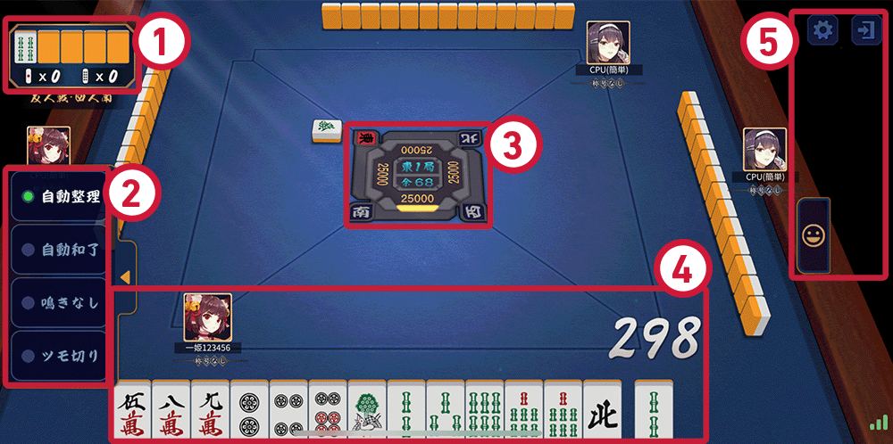
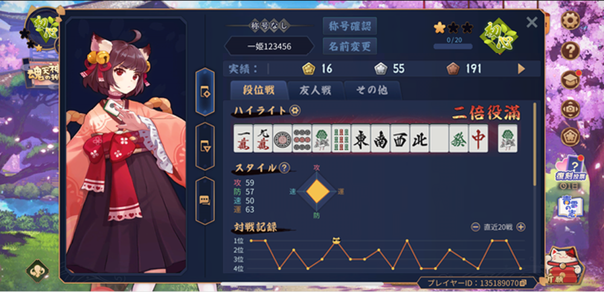
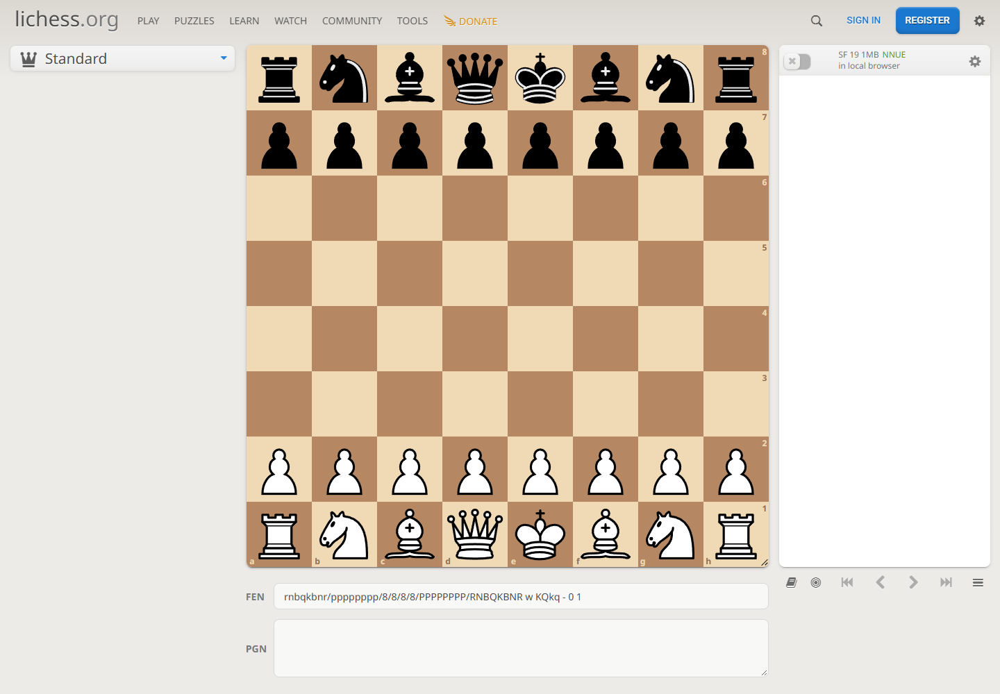
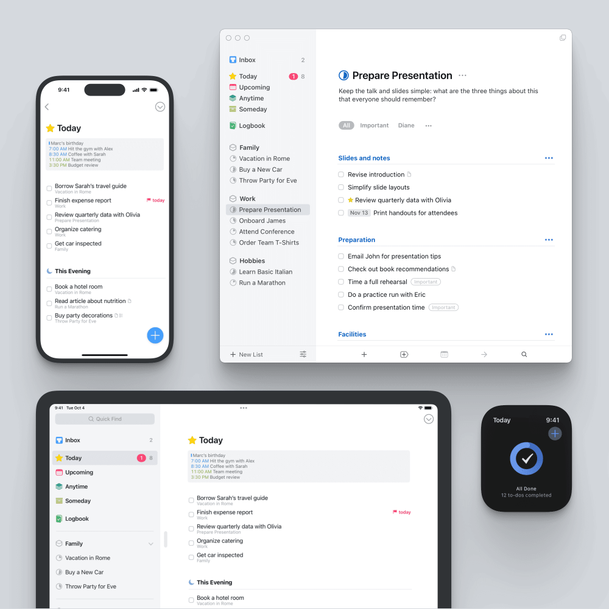

# 日麻记分产品：视觉参考与设计方向

研究日期：2026-10-19。

**已确认偏好：可以偏雀魂的感觉，避免 AI 模板感。** 本文是视觉研究与设计建议，不是已经完成或经用户确认的最终设计稿。

产品始终服务于线下实体麻将：开局二维码签到，同桌全员可录入，Web／iOS／Android 实时同步。画面需要有麻将游戏的氛围，同时让现场玩家能很快完成记分。

## 1. 主参考：雀魂的大厅

[官方指南](https://mahjongsoul.com/startguide/) · [官方大厅截图](https://mahjongsoul.com/startguide/assets/img_login_10.png)


值得借鉴的是场景、人物和菜单共同组成一个有明确主题的空间。主入口具有可辨识的游戏按钮造型，玩家身份固定在左上，场景并非随意铺一层渐变。

本产品的落地建议：

- 大厅使用原创雀馆／桌面插画，保留真实麻将物件和空间层次。
- 主入口为「继续对局」「开桌」「扫码加入」；下方放「战绩」「工具」「我的」。
- 原创头像或小型角色位于边缘，开桌和继续操作位于视觉中心附近。
- 有未结束牌局时，显示最近局次和成员，直接进入；不让用户反复经过宣传页。

首发的重点是记分。角色立绘、动态桌布可以增强氛围，但应作为独立美术任务估算，不用临时拼凑的通用 AI 人物占据主要界面。

## 2. 最重要的参考：雀魂的对局桌面

[官方对局说明](https://mahjongsoul.com/startguide/) · [官方牌桌截图](https://mahjongsoul.com/startguide/assets/img_tutorial_01.png)



可借鉴的重点是蓝色桌布、四方玩家关系、中央局次盘、麻将牌的实体边缘和功能面板的统一材质。截图上的红色说明框属于官方教程标注，不是拟采用的 UI。

本产品不显示虚构牌山或未录入的手牌。保留桌面与方位结构，把空间用于四位玩家的姓名、点数、立直状态和本局增减：

```text
                 对家：姓名、风位、点数

 上家：姓名、点数     东二局／1 本场     下家：姓名、点数
                    供托 2 根

                 自家：姓名、风位、点数

        立直         和牌         流局         记录
        已同步 · 最近一条由小林录入
```

这是信息结构草图，不是最终像素布局。头像、风位牌和点棒提供麻将辨识度；大分数字体承担首要阅读任务。

操作建议：点选任意玩家后出现对应录入面板，所有参赛成员均可操作。选完胜者／放铳者和番符，先显示支付预览，再提交。按钮可采用轻微切角、压边和材质高光，但小号正文和输入框保持清晰。

手机竖屏使用紧凑桌面和底部录入面板；四位分数都朝向操作人。横屏和平板允许更完整桌面。旋转玩家文字只用于用户主动选择的共用桌面显示模式。

## 3. 雀魂的个人战绩面板

[官方个人资料截图](https://mahjongsoul.com/startguide/assets/img_features_other_02.png)



可借鉴：深色面板、金色边线、头像与资料分区、局部高亮和清楚的页签。图表与人物有主次关系，画面属于同一套游戏视觉。

本产品建议采用头像＋昵称＋概览、规则筛选、顺位趋势、历史对局列表的结构。四麻和三麻分开统计。每条记录可展开局结果、操作者和修订历史。

统计只能基于实际记录的数据。首发可展示对局数、平均顺位、各顺位比例、竞技分和已记录局的和牌／放铳情况。不能照搬一个没有数据定义的“攻防运气”雷达图，也不能把线下未核对战绩包装成官方段位。

## 4. 辅助参考：Lichess 的操作分区

[实际页面：Lichess Analysis](https://lichess.org/analysis)



借鉴的是棋盘中心、辅助工具在侧边、记录在独立区域的布局关系。用于桌面端安排「主牌桌＋右侧录入／事件列表」，让玩家不会在大量卡片之间寻找当前操作。颜色、棋子和品牌不作为本产品主风格。

本次打开的是初始棋盘，截图中记录区为空；它是布局参考，不是一次完整在线棋局体验测试。

## 5. 辅助参考：Things 的多端信息层级

[官方功能页](https://culturedcode.com/things/features/)



借鉴列表层级、清晰标签和逐步展开详细信息的做法，主要用于账户安全、设备管理、规则设置和战绩列表。截图来自其官网产品展示，并非本次登录使用其 App 的截图。

例如「设备与登录」应直接列出设备、最近活动和退出操作；「二维码签到」应直接显示座位与确认状态。这些界面可以沿用麻将主题外框，但不能因装饰让重要操作难找。

## 6. 本产品视觉草案

建议采用“有麻将游戏质感的记分桌”方向。以下数值是起始方案，落地时需校验可读性与真机效果。

| 元素 | 初始建议 | 用途 |
|---|---|---|
| 牌桌蓝 | `#29476A` | 对局核心背景，可配原创低对比桌布纹理 |
| 面板藏蓝 | `#1C2942` | 结算、资料和辅助面板 |
| 旧金色 | `#C4A66A` | 边缘、选中状态及主操作点缀，不用作小号低对比正文 |
| 牌面白 | `#F3F1E8` | 麻将牌和局部浅色内容区 |
| 主文字 | `#F5F5EF` | 深色面板中的主要内容 |
| 朱红 | `#B64347` | 立直印记、危险操作等少量明确状态 |

文字采用清晰的系统中文字体处理正文、数字和表单；数字使用等宽数字特性保持对齐。风位和局次可使用具有明确授权的特色字体，不能让装饰字体影响金额、点数或安全提示。首发中文优先，布局预留英文和日文长度。

组件分工：牌桌与头像可有实体层次；数据行与设置区使用清楚的对齐与间距；弹出录入面板只展示当前必要字段。不要给所有东西套相同圆角、相同阴影、相同渐变卡片。

动效只回答具体动作：立直棒进入中央供托区、确认后点数变动、和牌后短暂强调胜者。日常输入反馈建议 150–250 毫秒，结算演出可关闭，不阻塞下一次录入。支持静音、减少动画及大字模式。

触控区以 iOS 44pt、Android 48dp 的平台目标设计，Web 结合实际设备与可访问性要求实现。不能把不同平台单位混为一个尺寸。颜色变化必须同时有文本或图形状态，错误和断网不能只靠红绿区别。

## 7. 二维码签到页面

签到是本产品的特色流程，应作为首批重点设计页面，与牌桌同等优先：

```text
                 周六半庄
             四麻家规 v1 · 25,000 点

                 [签到二维码]
                 30 秒后刷新

      东  阿青   已到场       南  小林   已到场
      西  小陈   待确认       北  空位   等待加入

              2 / 4 人已确认到场
              [等待成员到齐]
```

房主视图突出二维码和名单；成员视图突出自己的座位、规则摘要与「我已到场」。二维码区域使用高对比纯色底，不覆盖纹理或动画。过期时原地更新；拒绝相机权限时提供输入入桌码。开始后进入同一牌桌，全员可以录入，不再连续检测现场距离。

## 8. 素材与验证要求

上述图片通过浏览器从公开官方页面获取，仅作为带来源的研究参考。雀魂角色、商标、立绘、桌布和音效不随产品打包；应建立原创／授权素材清单，记录作者、许可范围与源文件。

规则编辑与模板库也列入首批设计稿：四麻／三麻预置分组，私人模板在同一列表中可见；设置页把起始点、返还点、流局罚符、本场等数值和含义并列，改动即由正式计分引擎更新一听／两听和牌局结算示例。底部固定「仅用于本桌」「另存为我的模板」；保存后返回开桌页可直接应用。P0 已保存模板只读，编辑已有模板和归档入口留待 P1。预置模板展示来源与差异，不用未经核验的「官方」徽章。

首批设计稿优先做：竖屏牌桌、结果录入、二维码签到、规则编辑与模板库、结算、账户设备管理，再补大厅与桌面端。验收时用真实的四人姓名、五位点数、负分、多个立直、长昵称和同步冲突检验界面，不用只有漂亮默认状态的静态展示代替。

本次已查看并保存主参考与辅助参考截图；没有制作最终 UI、原创角色、可运行原型或完整品牌系统。
